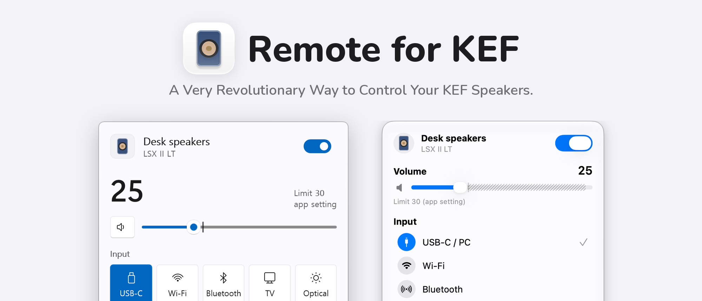

  <picture>
    <source media="(prefers-color-scheme: dark)" srcset="docs/images/banner-en-dark.png">
    
  </picture>

English · <a href="README_ko.md">한국어</a> · <a href="README_jp.md">日本語</a>

  <a href="https://github.com/kimdaehee0824/Remote-for-KEF/releases/latest/download/RemoteForKEF-win-x64.zip"><picture><source media="(prefers-color-scheme: dark)" srcset="docs/images/download-windows-dark.svg"></picture></a>
  &nbsp;
  <a href="https://github.com/kimdaehee0824/Remote-for-KEF/releases/latest/download/RemoteForKEF-macos.zip"><picture><source media="(prefers-color-scheme: dark)" srcset="docs/images/download-macos-dark.svg"></picture></a>

**Remote for KEF** controls your KEF wireless speaker from the Windows tray and the Mac menu bar, directly over the local network. No more reaching for your phone to switch inputs or nudge the volume.

- Power, inputs and volume in steps of 1
- A volume limit, and accurate volume so the same number always sounds the same
- Shortcuts and an on-screen volume display on Windows

How each screen and feature works is in the [User guide](docs/guide.md).

## Install

The builds aren't signed, so each system asks once on first launch.

- **Windows 10 (1809) or 11**: unzip, run `RemoteForKEF.exe` and choose **More info → Run anyway**. The ARM64 build is on [Releases](https://github.com/kimdaehee0824/Remote-for-KEF/releases).
- **macOS 14 or later**: move the app to Applications, open it and click **Open Anyway** in **System Settings → Privacy & Security**. Allow Local Network access when asked.

Then enter the speaker's IP address in Settings. More in the [User guide](docs/guide.md#getting-started).

Tested on the KEF LSX II LT. The LSX II, LS50 Wireless II, LS60, XIO and LS LUXE use the same protocol but haven't been tested yet.

## Thanks

- [kef-lsx-volume](https://github.com/roberdorfer/kef-lsx-volume) by Robert Oberdorfer, whose volume curve measurements are behind accurate volume and the volume steps.
- [homeassistant-kef](https://github.com/EvotecIT/homeassistant-kef), the reference for the KEF network protocol.

[Contributing](CONTRIBUTING.md) · [MIT License](LICENSE) · [Third-party notices](THIRD-PARTY-NOTICES.md)

Not affiliated with or endorsed by KEF. KEF and product names are trademarks of their owners.
