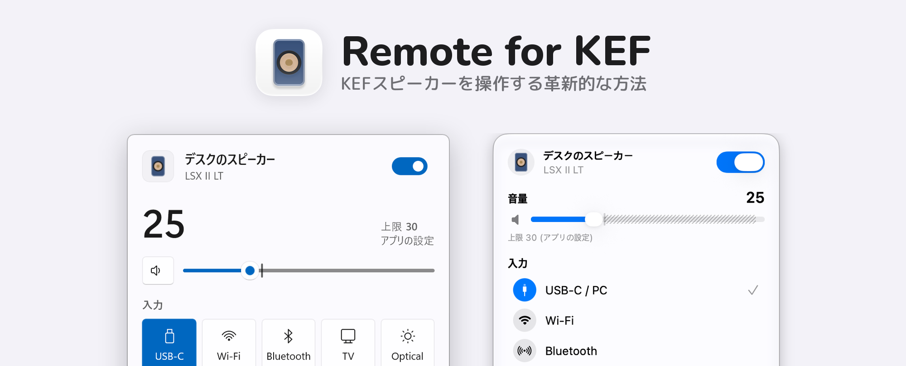

  <picture>
    <source media="(prefers-color-scheme: dark)" srcset="docs/images/banner-ja-dark.png">
    
  </picture>

<a href="README.md">English</a> · <a href="README_ko.md">한국어</a> · 日本語

  <a href="https://github.com/kimdaehee0824/Remote-for-KEF/releases/latest/download/RemoteForKEF-win-x64.zip"><picture><source media="(prefers-color-scheme: dark)" srcset="docs/images/download-windows-dark.svg"></picture></a>
  &nbsp;
  <a href="https://github.com/kimdaehee0824/Remote-for-KEF/releases/latest/download/RemoteForKEF-macos.zip"><picture><source media="(prefers-color-scheme: dark)" srcset="docs/images/download-macos-dark.svg"></picture></a>

**Remote for KEF**は、WindowsのタスクトレイとMacのメニューバーから、ローカルネットワーク経由でKEFのワイヤレススピーカーを直接操作します。入力の切り替えや少しの音量調整のたびに、スマートフォンを手に取る必要はありません。

- 電源、入力、1刻みの音量
- 音量の上限と、同じ数値ならいつも同じ大きさで聞こえる正確な音量合わせ
- Windowsのショートカットキーと画面の音量表示

画面と機能ごとの使い方は[使い方ガイド](docs/guide_jp.md)にあります。

## インストール

署名していないビルドのため、初回起動時に一度だけOSの確認が表示されます。

- **Windows 10（1809）または11**: zipを展開して`RemoteForKEF.exe`を実行し、**詳細情報 → 実行**を選びます。ARM64版は[Releases](https://github.com/kimdaehee0824/Remote-for-KEF/releases)にあります。
- **macOS 14以降**: アプリを「アプリケーション」フォルダに移して開き、**システム設定 → プライバシーとセキュリティ**で**このまま開く**をクリックします。ローカルネットワークへのアクセスを求められたら許可してください。

あとは設定でスピーカーのIPアドレスを入力するだけです。詳しくは[使い方ガイド](docs/guide_jp.md#はじめに)をご覧ください。

KEF LSX II LTで確認しています。LSX II、LS50 Wireless II、LS60、XIOは同じプロトコルですが、まだ確認していません。

## 謝辞

- Robert Oberdorfer氏の[kef-lsx-volume](https://github.com/roberdorfer/kef-lsx-volume)。正確な音量合わせと音量ステップは、このプロジェクトが公開している音量カーブの測定値をもとにしています。
- [homeassistant-kef](https://github.com/EvotecIT/homeassistant-kef)。KEFのネットワークプロトコルを参考にしました。

[コントリビューション](CONTRIBUTING.md) · [MIT License](LICENSE) · [オープンソースライセンス](THIRD-PARTY-NOTICES.md)

KEFとは関係のない非公式プロジェクトです。KEFおよび製品名は各社の商標です。
