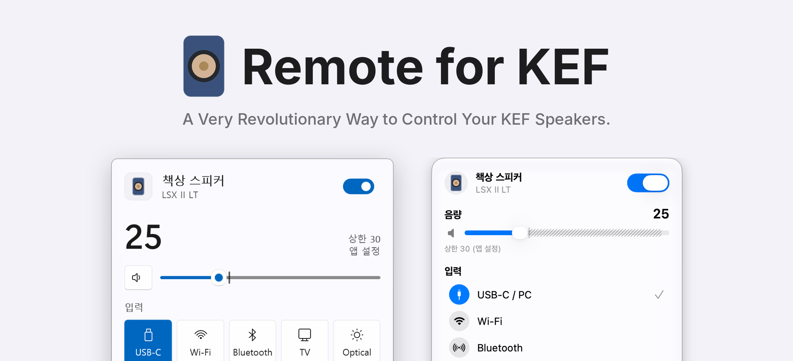
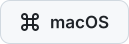

  <picture>
    <source media="(prefers-color-scheme: dark)" srcset="docs/images/banner-ko-dark.png">
    
  </picture>

<a href="README.md">English</a> · 한국어 · <a href="README_jp.md">日本語</a>

  <a href="https://github.com/kimdaehee0824/Remote-for-KEF/releases/latest/download/RemoteForKEF-win-x64.zip"><picture><source media="(prefers-color-scheme: dark)" srcset="docs/images/download-windows-dark.svg"></picture></a>
  &nbsp;
  <a href="https://github.com/kimdaehee0824/Remote-for-KEF/releases/latest/download/RemoteForKEF-macos.zip"><picture><source media="(prefers-color-scheme: dark)" srcset="docs/images/download-macos-dark.svg"></picture></a>

**Remote for KEF**는 Windows 트레이와 Mac 메뉴 막대에서 로컬 네트워크로 KEF 무선 스피커를 직접 조작합니다. 입력을 바꾸거나 음량을 조금 바꾸려고 휴대폰을 집어 들 필요가 없습니다.

- 전원, 입력, 1 단위 음량
- 음량 상한, 그리고 같은 숫자는 늘 같은 크기로 들리게 하는 정확한 음량 맞추기
- Windows 단축키와 화면 음량 표시

화면과 기능별 사용법은 [사용 설명서](docs/guide_ko.md)에 있습니다.

## 설치

서명하지 않은 빌드라서 처음 실행할 때 한 번 확인을 거칩니다.

- **Windows 10(1809) 또는 11**: zip을 풀고 `RemoteForKEF.exe`를 실행한 뒤 **추가 정보 → 실행**을 누릅니다. ARM64용은 [Releases](https://github.com/kimdaehee0824/Remote-for-KEF/releases)에 있습니다.
- **macOS 14 이상**: 앱을 응용 프로그램 폴더로 옮겨 열고, **시스템 설정 → 개인정보 보호 및 보안**에서 **그래도 열기**를 누릅니다. 로컬 네트워크 접근을 물으면 허용해 주세요.

그다음 설정에서 스피커 IP 주소를 넣으면 됩니다. 자세한 내용은 [사용 설명서](docs/guide_ko.md#시작하기)에 있습니다.

KEF LSX II LT에서 확인했습니다. LSX II, LS50 Wireless II, LS60, XIO, LS LUXE는 같은 프로토콜을 쓰지만 아직 확인하지 않았습니다.

## 감사의 말

- Robert Oberdorfer의 [kef-lsx-volume](https://github.com/roberdorfer/kef-lsx-volume). 정확한 음량 맞추기와 음량 단계는 이 프로젝트가 공개한 음량 곡선 측정값을 바탕으로 했습니다.
- [homeassistant-kef](https://github.com/EvotecIT/homeassistant-kef). KEF 네트워크 프로토콜을 참고했습니다.

[기여하기](CONTRIBUTING.md) · [MIT License](LICENSE) · [오픈소스 고지](THIRD-PARTY-NOTICES.md)

KEF와 관계없는 비공식 프로젝트입니다. KEF와 제품명은 각 소유자의 상표입니다.
