# User guide

English · [한국어](guide_ko.md) · [日本語](guide_jp.md)

A walk through each screen of Remote for KEF. The numbers in each picture match the list under it.

- [Getting started](#getting-started)
- [Windows](#windows)
- [macOS](#macos)
- [Volume limit and accurate volume](#volume-limit-and-accurate-volume)
- [Speaker drawings](#speaker-drawings)
- [Troubleshooting](#troubleshooting)

## Getting started

### Install

- **Windows**: unzip and run `RemoteForKEF.exe`. The app isn't signed, so if SmartScreen appears, choose **More info → Run anyway**. Move the folder somewhere it can stay, rather than running it from Downloads.
- **macOS**: unzip, move **Remote for KEF** to Applications and open it. If macOS says it can't be opened, go to **System Settings → Privacy & Security** and click **Open Anyway**. Allow Local Network access when asked, or the speaker can't be reached.

### Connect the speaker

1. Find the speaker's IP address, in the speaker info in the KEF Connect app or on your router's admin page. Reserving a fixed IP for the speaker on the router keeps the address from changing.
2. Enter the IP address on the **Speaker** page in Settings and connect. See it for [Windows](#settings-speaker) and [macOS](#settings-speaker-1).
3. Enter a password only if you set a device password in KEF Connect. It isn't your KEF account password.

Connecting only reads the speaker's status. It never changes the volume or the input.

## Windows

### Flyout

Select the icon in the notification area of the taskbar. If you don't see it, look under the ^ on the taskbar.

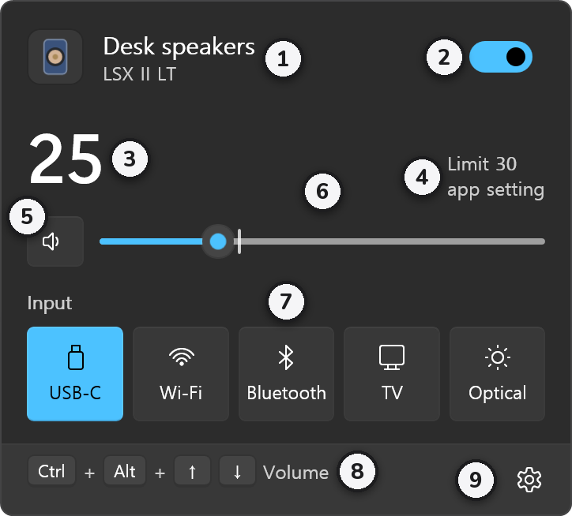

1. **Speaker name and model**
2. **Power**: turning it off puts the speaker in standby.
3. **Volume**: the value the speaker reports back.
4. **Limit**: the limit in effect, and whether it comes from the app setting or the KEF device setting.
5. **Mute**: each press mutes or unmutes.
6. **Volume slider**: moves in steps of 1. The tick is the limit; it doesn't go past it.
7. **Input**: switches to that input. The speaker is muted while switching, and unmuted only if the new input isn't louder than before and is within the limit.
8. **Shortcut hint**: the shortcut for volume up and down.
9. **Settings and quit**: Settings, About and Quit.

### Turn on from standby

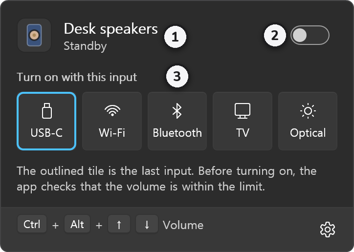

1. **Standby** shows under the name.
2. Turning on **Power** uses the last input.
3. Selecting an input turns the speaker on with that input. The outlined tile is the last input.

Before turning on, the app checks that the volume is within the limit. If the volume before standby is above it, the speaker stays off and the app says why.

### Muted

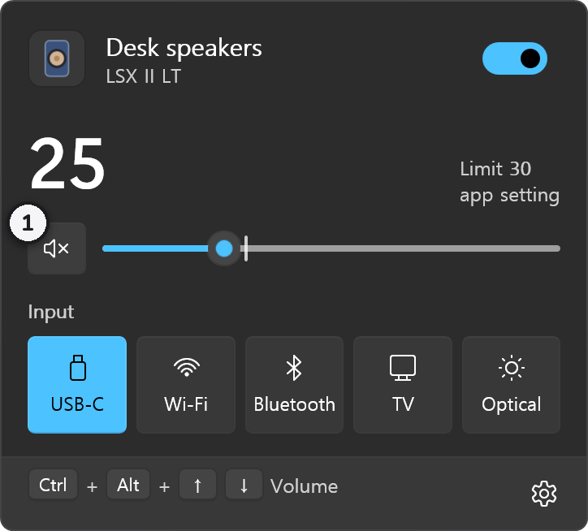

1. While muted, the button's speaker has an ×. Press it again to unmute.

### Shortcuts and the volume indicator

From any app, <kbd>Ctrl</kbd>+<kbd>Alt</kbd>+<kbd>↑</kbd> / <kbd>↓</kbd> changes the volume and <kbd>Ctrl</kbd>+<kbd>Alt</kbd>+<kbd>M</kbd> mutes or unmutes. When the volume changes, an indicator shows briefly in the bottom-right corner of the monitor with the mouse pointer.

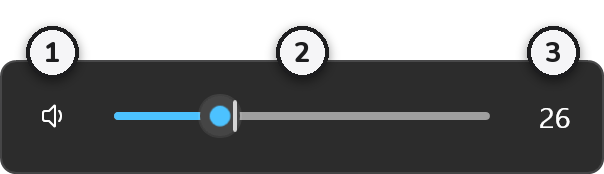

1. **Speaker icon**: select it to mute or unmute.
2. **Volume bar**: the tick is the limit. The mouse wheel over the indicator changes the volume too.
3. **Current volume**

If another app uses the same combination, **Check shortcuts** shows at the bottom of the flyout. VS Code, JetBrains IDEs, Visual Studio and Word use some of these too, so change them in **Settings → Shortcuts** if they clash.

### Settings: General

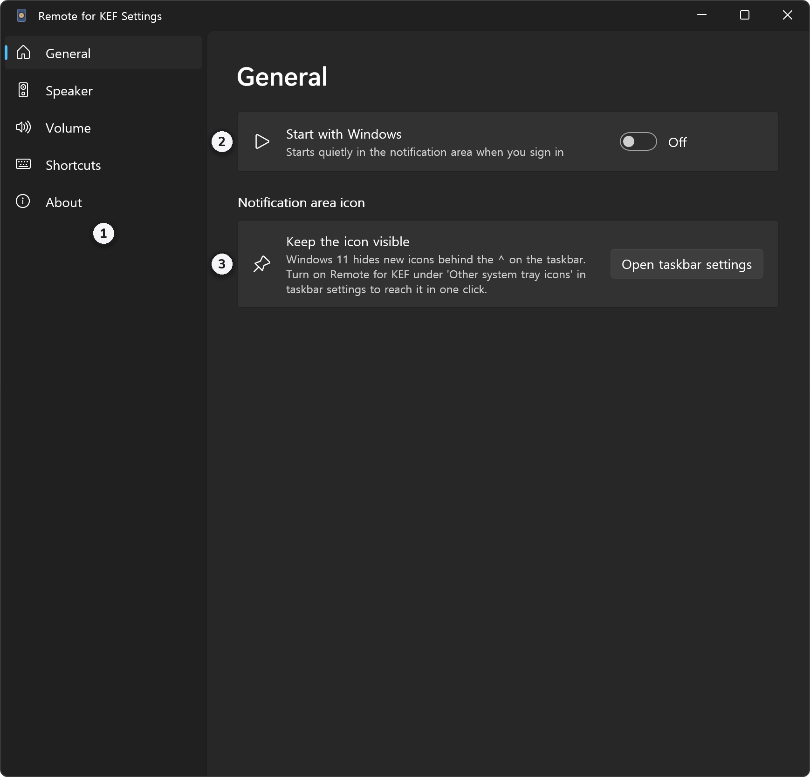

1. **Menu**: General, Speaker, Volume, Shortcuts and About.
2. **Start with Windows**: starts quietly in the notification area when you sign in.
3. **Keep the icon visible**: Windows 11 hides new icons under the ^. Select **Open taskbar settings** and turn on Remote for KEF to reach it in one click.

### Settings: Speaker

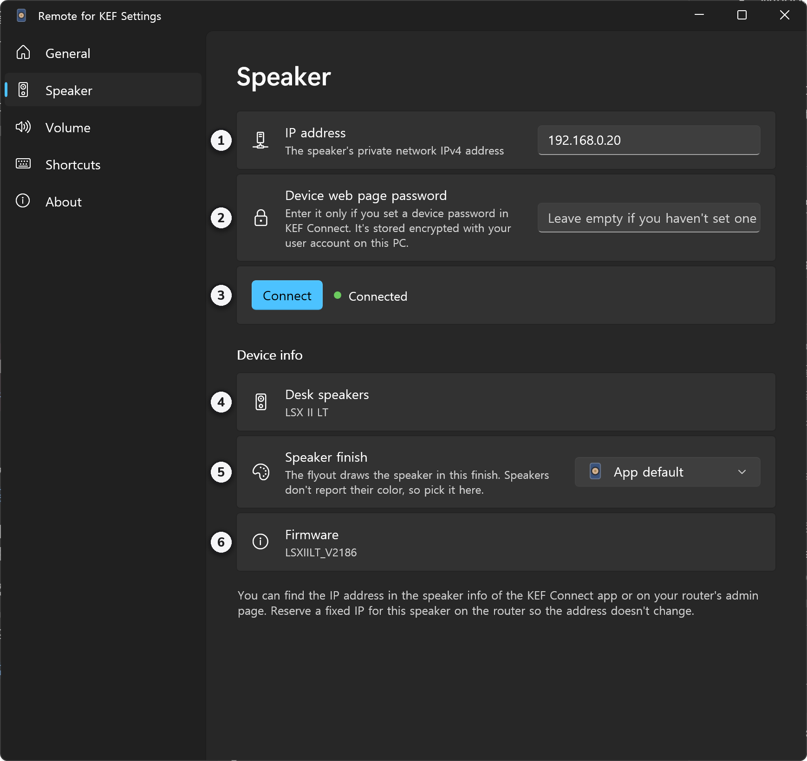

1. **IP address**
2. **Device web page password**: leave it empty if you haven't set one. It is stored encrypted for your Windows user.
3. **Connect**: the connection status shows next to it.
4. **Device name and model**: as the speaker reports them once connected.
5. **Speaker finish**: speakers don't report their color, so pick it here. The list shows only your model's finishes, and the speaker in the flyout takes the one you pick. Without one it uses the app's default, LS60 Royal Blue. The drawings for each model are [below](#speaker-drawings).
6. **Firmware**

### Settings: Volume

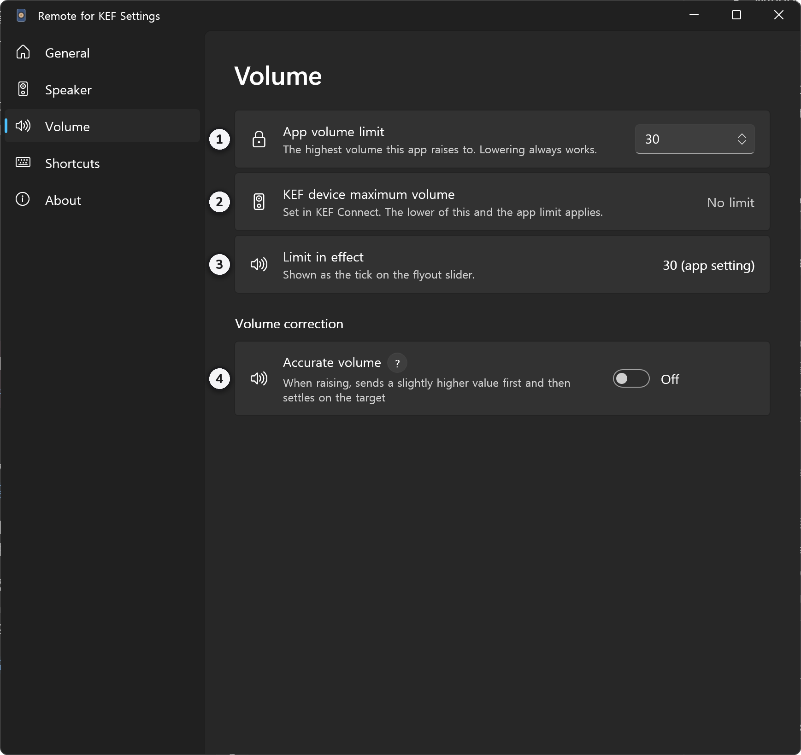

1. **App volume limit**: the highest volume this app raises to.
2. **KEF device maximum volume**: the value set in KEF Connect.
3. **Limit in effect**: the lower of the two. It is the tick on the flyout slider.
4. **Accurate volume**: **?** shows a short explanation. More [below](#accurate-volume).

### Settings: Shortcuts

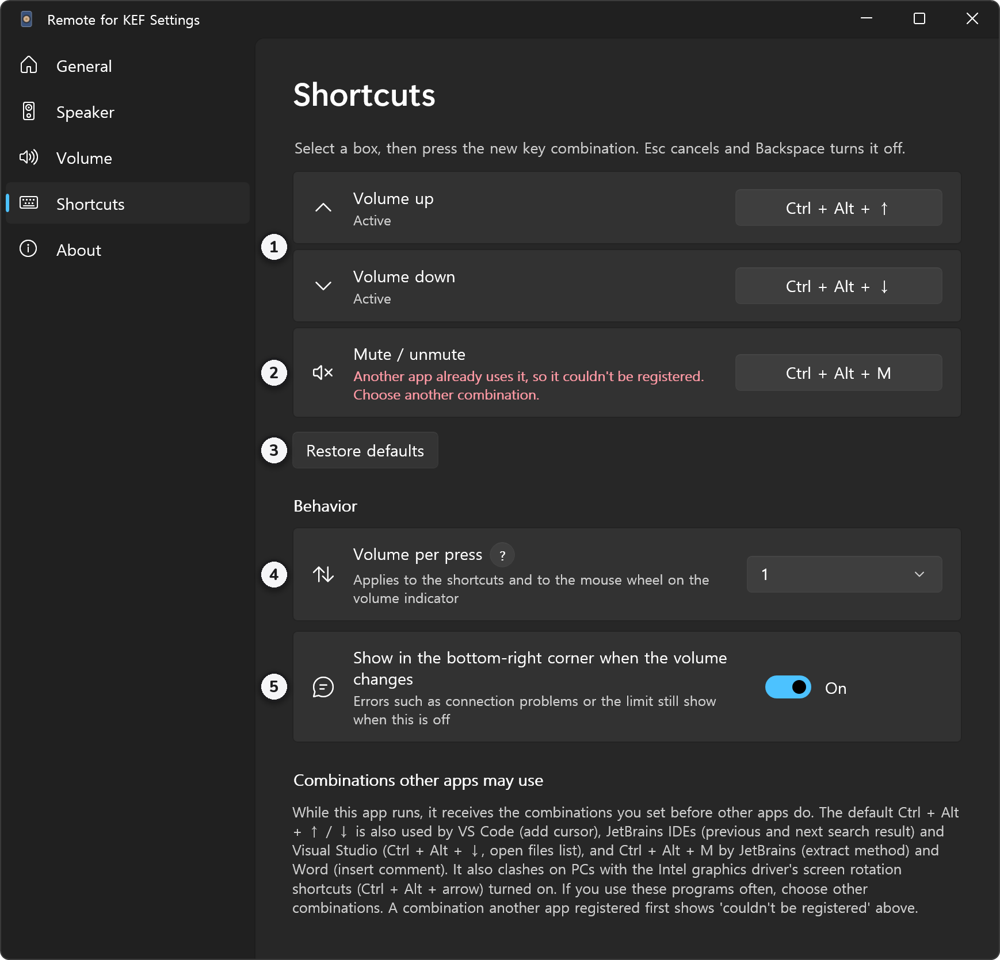

1. **Volume up**, **Volume down**: select a box and press the new combination. <kbd>Esc</kbd> cancels, <kbd>Backspace</kbd> turns it off.
2. **Mute / unmute**: the picture shows what happens when another app already uses <kbd>Ctrl</kbd>+<kbd>Alt</kbd>+<kbd>M</kbd>. If you see red text like this, choose another combination.
3. **Restore defaults**: puts the three shortcuts back to their original combinations.
4. **Volume per press**: 1, 2, 3 or 5, or **Perceived loudness**. It applies to the shortcuts and to the mouse wheel on the indicator.
5. **Show in the bottom-right corner when the volume changes**: errors such as connection problems or the limit still show when this is off.

**Perceived loudness** follows measured steps (12, 15, 19, 22, 25, 29 …) so the loudness, not the number, rises evenly. Above 65 it moves by 4; below 12, raising goes to 12 and lowering goes to 0.

## macOS

### Menu bar icon

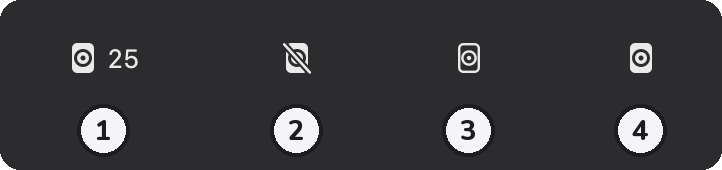

The icon's shape shows the speaker's state. Click it to open the panel.

1. **On**: the number next to it is the volume.
2. **Muted**
3. **Standby**
4. **Number off**: turning off **Show the volume in the menu bar** in Settings leaves only the icon.

When the connection is lost, the icon changes shape once more.

### Panel

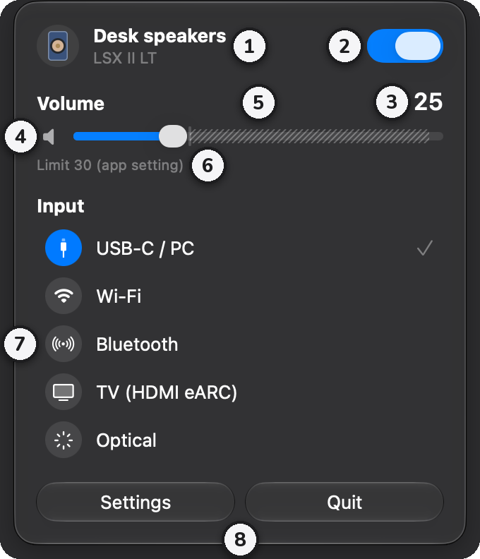

1. **Speaker name and model**
2. **Power**: turning it off puts the speaker in standby.
3. **Volume**: the value the speaker reports back.
4. **Mute**: click the speaker icon to mute or unmute.
5. **Volume slider**: the hatched part is above the limit, so the slider doesn't go there.
6. **Limit**: the limit in effect and where it comes from.
7. **Input**: switches to that input; the checkmark is the current one. Switching works as on Windows.
8. **Settings** and **Quit**

### Turn on from standby

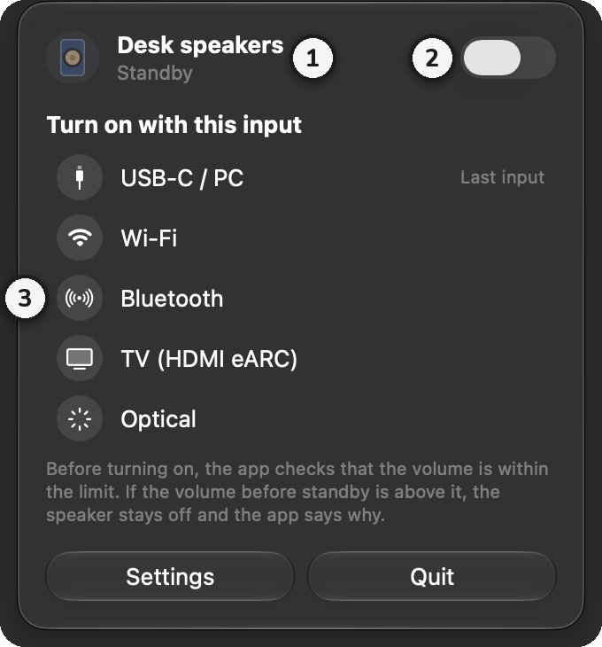

1. **Standby** shows under the name.
2. Turning on **Power** uses the last input.
3. Clicking an input turns the speaker on with that input. The one marked **Last input** is the last input.

### Muted

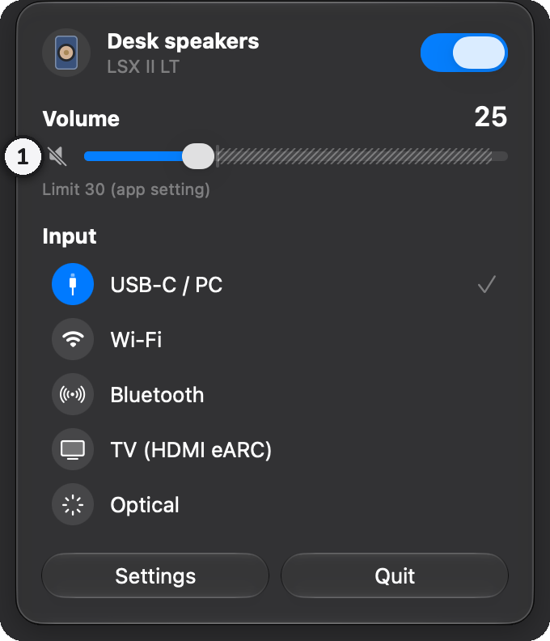

1. While muted, the speaker icon is crossed out. Click it again to unmute.

### Settings: General

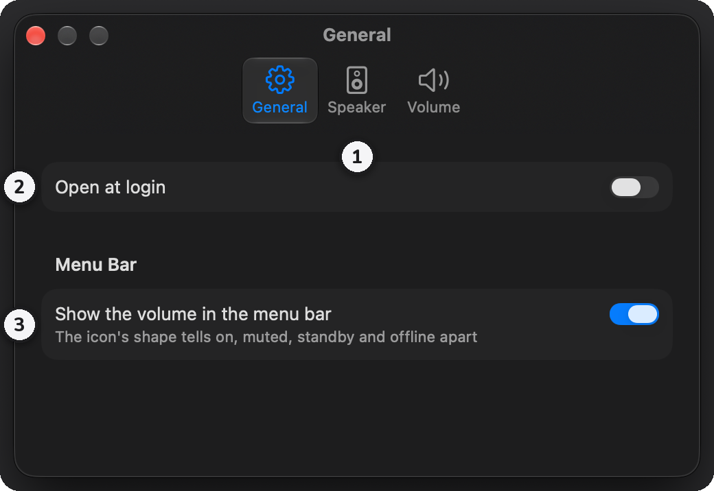

1. **Tabs**: General, Speaker and Volume
2. **Open at login**: may need approval in System Settings the first time.
3. **Show the volume in the menu bar**: on by default. Off leaves only the icon.

### Settings: Speaker

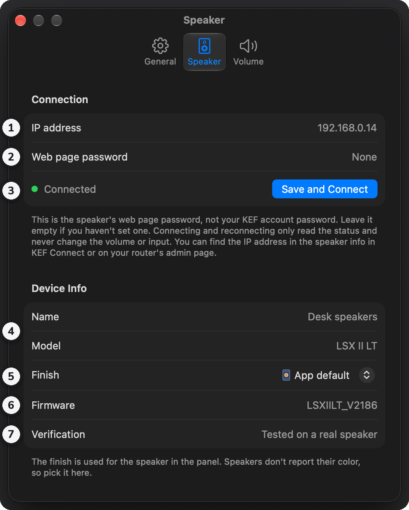

1. **IP address**
2. **Web page password**: leave it empty if you haven't set one. It is stored in the keychain.
3. **Save and Connect**: the connection status shows on the left.
4. **Name and model**: as the speaker reports them once connected.
5. **Finish**: the color of the speaker in the panel. The list shows only your model's finishes; without one it uses the app's default, LS60 Royal Blue. The drawings for each model are [below](#speaker-drawings).
6. **Firmware**
7. **Verification**: whether the model has been tested on a real speaker.

### Settings: Volume

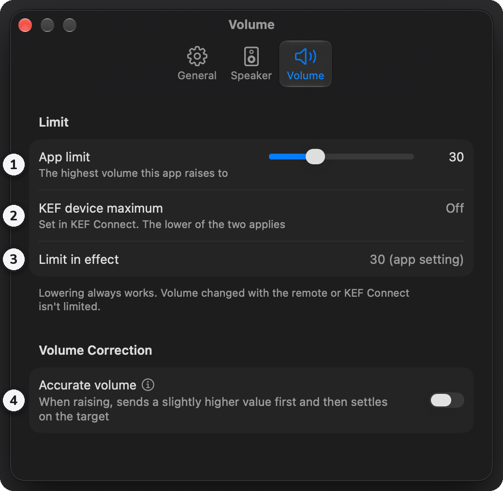

1. **App limit**: set with the slider.
2. **KEF device maximum**
3. **Limit in effect**
4. **Accurate volume**: the ⓘ next to it shows a short explanation.

## Volume limit and accurate volume

### Volume limit

There are two limits, and the lower one applies: the **app limit** set in this app, and the **KEF device maximum** set in KEF Connect. Lowering always works, and volume changed with the remote or KEF Connect isn't limited. If the volume is already above the limit, you can only lower it.

### Accurate volume

In some ranges a KEF speaker sounds quieter at the same number when the volume comes up from below. With this on, raising the volume first sends a slightly higher value and then the target 0.1 seconds later, so it sounds as loud as coming down from above.

- Raising to 20 goes through 22, and raising to 12 goes through 17.
- Values of 5 or less and 41 or more are sent directly. The value in between never goes past the limit, and lowering is sent as is.

The measurements come from [kef-lsx-volume](https://github.com/roberdorfer/kef-lsx-volume), taken on an LSX II (USB input). They haven't been checked on the LSX II LT yet, so this is off by default.

## Speaker drawings

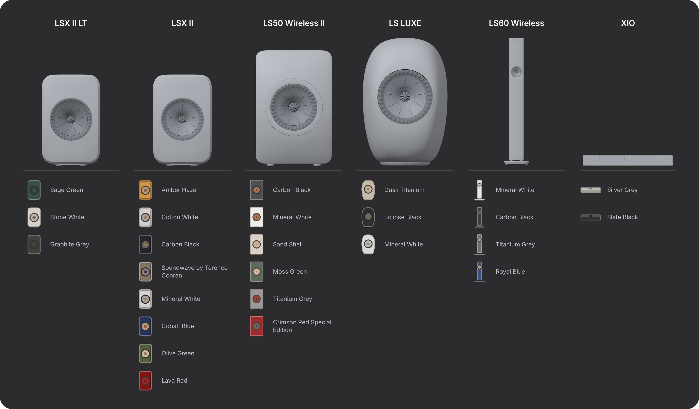

The speaker at the top of the flyout and the panel takes the shape of your model. The top row is KEF's 3D models rendered in a single color. The bottom row is how the app draws them in each finish, simplified so each model is still recognizable at a small size. The four bookshelf models are to scale; LS60 Wireless and XIO are reduced to fit.

- If you pick a finish, the app draws the model that finish belongs to, in that color.
- If you don't, it draws the detected model in the app's default color, LS60 Royal Blue.
- If the app doesn't know your model, you can choose the one to draw: **Speaker model** on the **Speaker** page of Settings on Windows, **Choose Model** on the **Speaker** tab of Settings on macOS. Until then the drawing is the one from the app icon.
- The finish list shows only your model's finishes, or only the app default if the model is unknown. The model choice affects the drawing and the finish list only, not the inputs.

## Troubleshooting

- **Can't connect**: check the speaker's power and Wi-Fi. The PC or Mac has to be on the same network as the speaker, and the speaker's IP address may have changed. On macOS, check that Remote for KEF is on in **System Settings → Privacy & Security → Local Network**. The app keeps retrying while the connection is lost.
- **Windows blocks the app**: with Smart App Control on, unsigned apps are blocked with no **Run anyway** button. It can't make an exception for one app, so the app only runs with Smart App Control off. Read [Microsoft's page](https://support.microsoft.com/en-us/topic/what-is-smart-app-control-285ea03d-fa88-4d56-882e-6698afdb7003) before turning it off.
- **A shortcut does nothing**: another app may use the same combination. Pick another one in **Settings → Shortcuts**.
- **The app can't turn the speaker on**: the app says so for devices that can't be turned on over the network. Use the remote or KEF Connect.
- **Anything else**: on Windows, logs are in **About → Settings and log folder** in Settings. Let me know in [Issues](https://github.com/kimdaehee0824/Remote-for-KEF/issues).
