# 使い方ガイド

[English](guide.md) · [한국어](guide_ko.md) · 日本語

Remote for KEFの画面を順に説明します。写真の番号と、その下の一覧の番号は同じです。

- [はじめに](#はじめに)
- [Windows](#windows)
- [macOS](#macos)
- [複数のスピーカー](#複数のスピーカー)
- [音量の上限と正確な音量合わせ](#音量の上限と正確な音量合わせ)
- [スピーカーの絵](#スピーカーの絵)
- [トラブルシューティング](#トラブルシューティング)

## はじめに

### インストール

- **Windows**: `RemoteForKEF-win-x64-Setup.exe`を実行します（ARMのPCは`-arm64-`）。署名していないアプリのため、SmartScreenが表示されたら**詳細情報 → 実行**を選びます。管理者権限なしで自分のアカウントにインストールされ、スタートメニューにショートカットができます。インストールせずに使う場合は、`RemoteForKEF-win-x64.zip`を置いておくフォルダーに展開して`Remote for KEF.exe`を開いてください。
- **macOS**: zipを展開して**Remote for KEF**をアプリケーションフォルダーに移し、開きます。ローカルネットワークへのアクセスを求められたら許可してください。許可しないとスピーカーに接続できません。

### スピーカーの接続

1. スピーカーのIPアドレスを確認します。KEF Connectアプリのスピーカー情報や、ルーターの管理画面で確認できます。ルーターでこのスピーカーに固定IPを割り当てておくと、アドレスが変わりません。
2. 設定の**スピーカー**画面にIPアドレスを入力して接続します。画面は[Windows](#設定-スピーカー)と[macOS](#設定-スピーカー-1)にあります。
3. KEF Connectで機器のパスワードを設定した場合だけ、パスワードも入力します。KEFアカウントのパスワードではありません。

ほかの部屋のスピーカーも同じ画面で追加できます。[複数のスピーカー](#複数のスピーカー)を参照してください。

接続ではスピーカーの状態を読むだけで、音量や入力は変えません。

リモコン、KEF Connect、ほかのアプリで変えた音量や入力もすぐに反映されます。数秒ごとに確認するだけでなく、変化があればスピーカーから知らせてもらうようにしているためです。

## Windows

### フライアウト

タスクバーの通知領域のアイコンをクリックすると開きます。アイコンが見当たらない場合は、タスクバーの^の中を見てください。

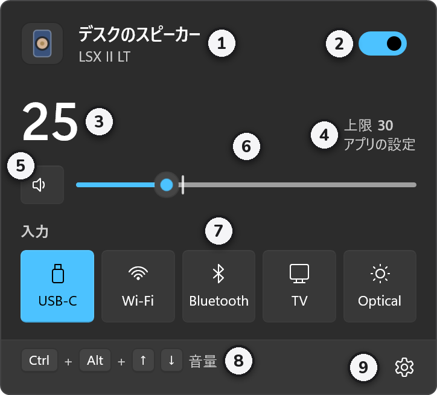

1. **スピーカーの名前とモデル**: スピーカーを2台以上登録すると名前の横に山かっこが付き、押すとほかのスピーカーを選ぶ一覧が開きます。
2. **電源**: オフにするとスピーカーがスタンバイになります。
3. **音量**: スピーカーが返した実際の値です。
4. **上限**: 現在の上限と、それがアプリの設定かKEF機器の設定かを表示します。
5. **ミュート**: 押すたびにミュートと解除が切り替わります。
6. **音量スライダー**: 1刻みで動きます。縦の目盛りが上限で、それより上には上がりません。
7. **入力**: 押すとその入力に切り替わります。切り替え中は一時的にミュートし、新しい入力の音量が前より高くなく上限の範囲内のときだけミュートを解除します。
8. **ショートカットの案内**: 音量を上げ下げするショートカットです。
9. **設定と終了**: 設定、バージョン情報、終了があります。

### スタンバイから電源を入れる

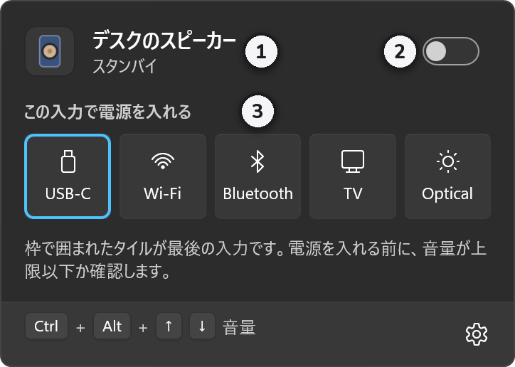

1. 名前の下に**スタンバイ**と表示されます。
2. **電源**をオンにすると、最後の入力で電源が入ります。
3. 入力を押すと、その入力ですぐに電源が入ります。枠のあるタイルが最後の入力です。

電源を入れる前に、音量が上限の範囲内かを確認します。スタンバイ前の音量が上限より高い場合は電源を入れず、理由を表示します。

### ミュート中

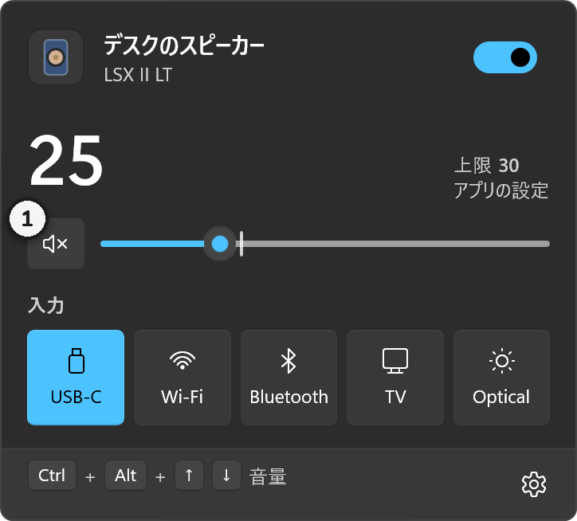

1. ミュート中はボタンのスピーカーに×が付きます。もう一度押すと解除されます。

### 再生中の曲

スピーカーがWi-FiやBluetoothで再生しているとき（Spotify Connect、AirPlay、Chromecastなど）、フライアウトの上に曲のカードが表示されます。Windows 11でクイック設定の上にメディアコントロールが出る位置です。

- 再生中のサービス、曲名とアーティスト、アートワークが表示されます。
- **前の曲**、**再生/一時停止**、**次の曲**はスピーカーのプレーヤーを直接操作します。サービスが許可していないボタンは薄く表示されます。
- フライアウトが開いているときだけ表示され、フォーカスを奪わないので、カードを押してもフライアウトは閉じません。
- 設定の**一般**にある**再生中の曲を表示**でオフにできます。

### ショートカットと音量表示

どのアプリからでも<kbd>Ctrl</kbd>+<kbd>Alt</kbd>+<kbd>↑</kbd> / <kbd>↓</kbd>で音量を、<kbd>Ctrl</kbd>+<kbd>Alt</kbd>+<kbd>M</kbd>でミュートを切り替えます。音量が変わると、マウスポインターのあるモニターの右下に音量表示が少しの間出ます。全画面のゲームや動画が前面にあるときは、画面を覆わないよう音量表示を出さずに音量だけを変えます。

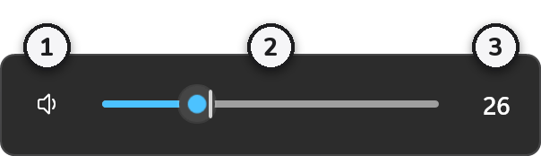

1. **スピーカーのアイコン**: 押すとミュートと解除が切り替わります。
2. **音量バー**: 縦の目盛りが上限です。音量表示の上でマウスホイールを回しても音量が変わります。
3. **現在の音量**

スピーカーが2台以上あると、音量表示の下の行にどのスピーカーかを名前で表示します。

ほかのアプリが同じ組み合わせを使っていると、フライアウトの下に**ショートカットを確認**と表示されます。VS Code、JetBrains IDE、Visual Studio、Wordも一部を使っているため、重なる場合は設定の**ショートカット**で変えてください。

### 設定: 一般

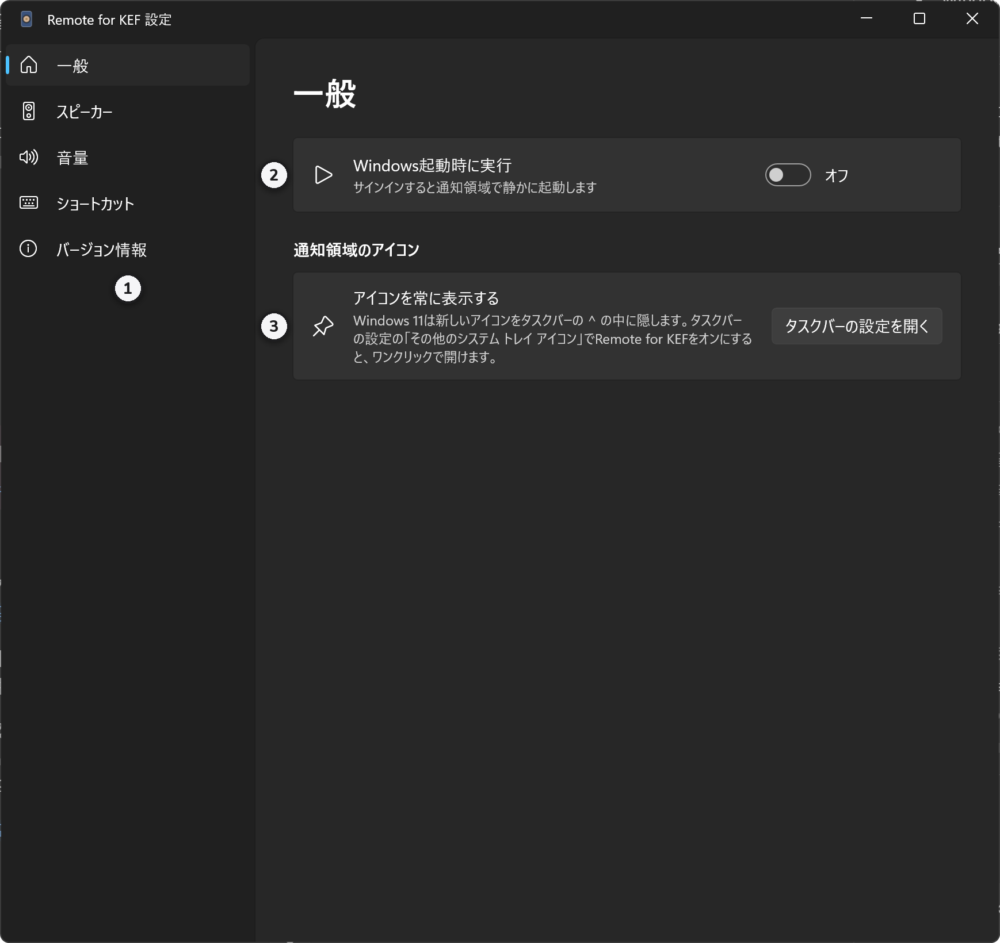

1. **メニュー**: 一般、スピーカー、ショートカット、バージョン情報の画面に移ります。
2. **Windows起動時に実行**: サインインすると通知領域で静かに起動します。
3. **アイコンを常に表示する**: Windows 11は新しいアイコンを^の中に隠します。**タスクバーの設定を開く**からRemote for KEFをオンにしておくと、1回のクリックで開けます。

同じ画面の下にある**アップデート**: **自動でアップデート**をオンにしておくと、1日に1回GitHubで新しいバージョンを確認してダウンロードし、次にアプリを起動したときに適用します。**アップデートを確認**ですぐに確認でき、**再起動してアップデート**でダウンロード済みのバージョンをすぐに適用します。

同じ画面の**フライアウト → 再生中の曲を表示**: フライアウトの上の曲のカードをオン/オフします。

### 設定: スピーカー

スピーカーが1台のときの画面です。2台以上では先に一覧が表示され、行を押すとそのスピーカーの同じ画面が開きます（[複数のスピーカー](#複数のスピーカー)）。

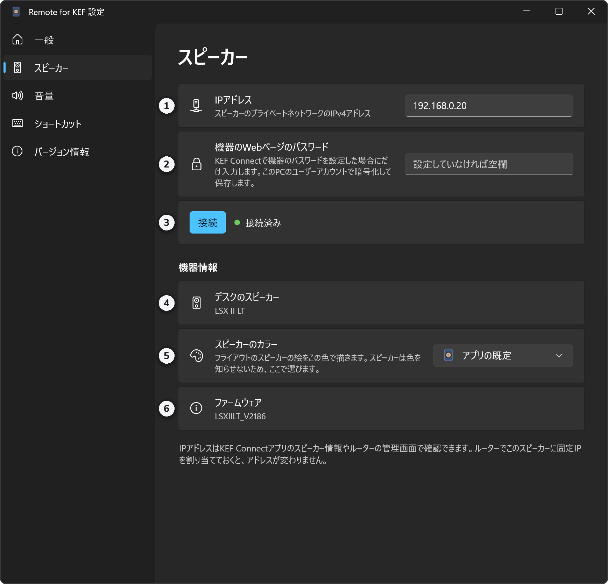

1. **IPアドレス**
2. **機器のWebページのパスワード**: 設定していなければ空欄のままにします。このPCのユーザーアカウントで暗号化して保存します。
3. **接続**: 横に接続の状態が表示されます。
4. **機器の名前とモデル**: 接続すると、スピーカーが返した値が表示されます。
5. **スピーカーのカラー**: スピーカーは自分の色を知らせないため、ここで選びます。一覧にはそのモデルのカラーだけが表示され、フライアウトのスピーカーの絵がこの色になります。選ばない場合はアプリの既定色（LS60 Royal Blue）です。モデルごとの絵は[下](#スピーカーの絵)にあります。
6. **ファームウェア**

同じ画面の下にある**音量**は、このスピーカーだけに適用されます。

- **アプリの音量上限**: このアプリで上げられる最大の音量です。
- **KEF機器の最大音量**: KEF Connectで設定した値です。
- **現在の上限**: 2つのうち低いほうです。フライアウトのスライダーの目盛りがこの値です。
- **正確な音量合わせ**: **?** ボタンを押すと短い説明が出ます。詳しくは[下](#正確な音量合わせ)で説明します。

その下の**このスピーカーを削除**は、このPCの一覧から削除するだけで、スピーカー自体は変わりません。画面の一番上の**スピーカーを追加**で、ほかの部屋のスピーカーを追加します。

### 設定: ショートカット

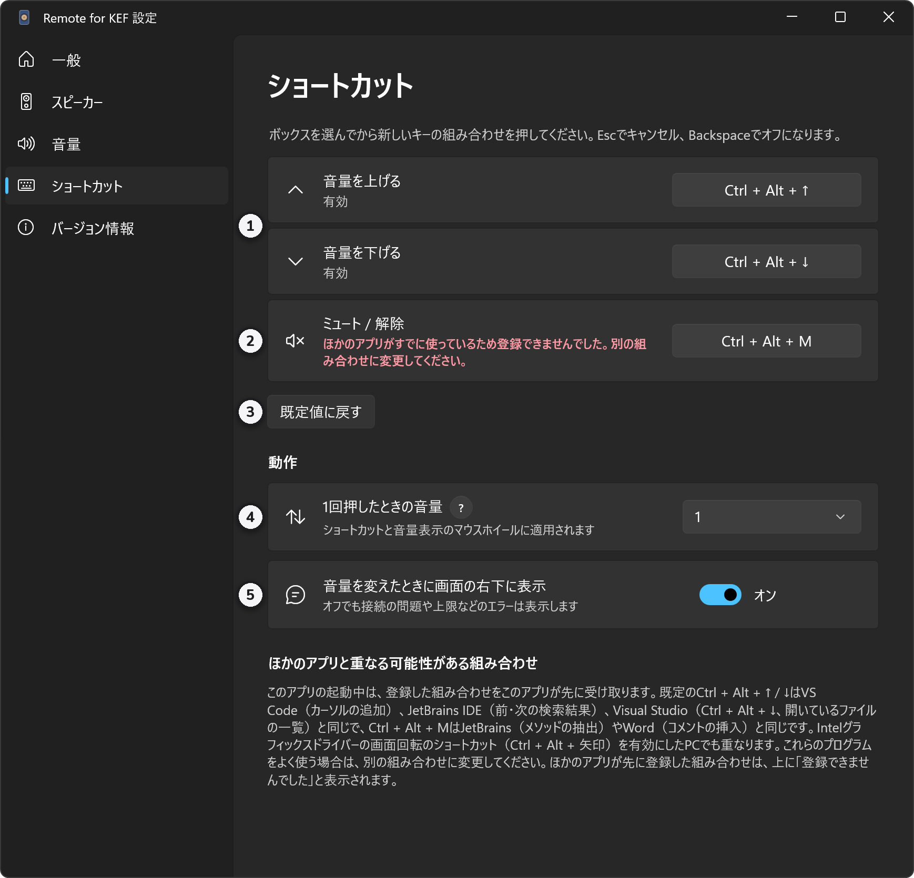

1. **音量を上げる**、**音量を下げる**: 枠をクリックして新しい組み合わせを押すと変わります。<kbd>Esc</kbd>で取り消し、<kbd>Backspace</kbd>でオフにします。
2. **ミュート / 解除**: 写真は、ほかのアプリが<kbd>Ctrl</kbd>+<kbd>Alt</kbd>+<kbd>M</kbd>を先に使っているときの表示です。このように赤い文字が出たら、別の組み合わせに変えてください。
3. **既定値に戻す**: ショートカットを最初の組み合わせに戻します。
4. **1回押したときの音量**: 1、2、3、5、または**体感音量**。ショートカットと音量表示のマウスホイールに適用されます。
5. **音量を変えたときに画面の右下に表示**: オフにしても、接続の問題や上限などのエラーは表示します。

同じ画面の**次のスピーカーに切り替える**は、初期設定ではオフです。組み合わせを決めておくと、スピーカーが2台以上のとき選択中のスピーカーを一覧の順に切り替えます。

**体感音量**は、同じ数ずつ足す代わりに、聞こえる大きさが均等に増えるように測った段階（12、15、19、22、25、29 …）に従います。65より上では4ずつ動き、12より下では上げると12、下げると0になります。

## macOS

### メニューバーのアイコン

アイコンの形でスピーカーの状態がわかります。アイコンをクリックするとパネルが開きます。

1. **オン**: 横の数字は現在の音量です。
2. **ミュート**
3. **スタンバイ**
4. **数字をオフにした場合**: 設定の**メニューバーに音量を表示**をオフにすると、アイコンだけになります。

接続が切れると、アイコンの形がもう一度変わります。

### パネル

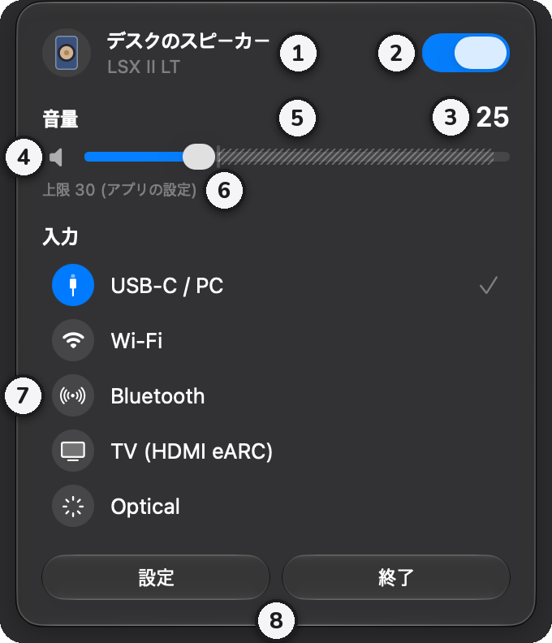

1. **スピーカーの名前とモデル**: スピーカーを2台以上登録すると名前の横に山かっこが付き、クリックするとパネルの横にほかのスピーカーを選ぶ一覧が開きます。
2. **電源**: オフにするとスタンバイになります。
3. **音量**: スピーカーが返した実際の値です。
4. **ミュート**: スピーカーのアイコンをクリックすると、ミュートと解除が切り替わります。
5. **音量スライダー**: 斜線の部分は上限より上なので、上がりません。
6. **上限**: 現在の上限と、その設定元です。
7. **入力**: クリックするとその入力に切り替わります。チェックマークが現在の入力です。切り替え方はWindowsと同じです。
8. **設定**と**終了**

### スタンバイから電源を入れる

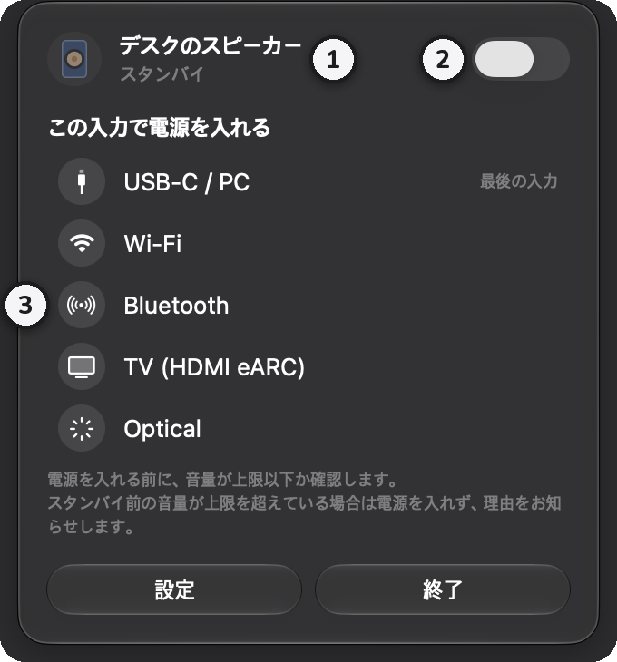

1. 名前の下に**スタンバイ**と表示されます。
2. **電源**をオンにすると、最後の入力で電源が入ります。
3. 入力をクリックすると、その入力ですぐに電源が入ります。**最後の入力**と書かれているのが最後の入力です。

### ミュート中

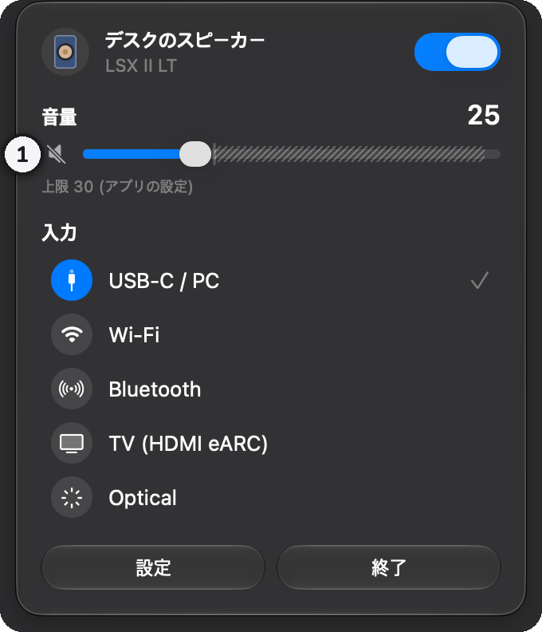

1. ミュート中はスピーカーのアイコンに斜線が入ります。もう一度クリックすると解除されます。

### 再生中の曲

スピーカーがWi-FiやBluetoothで再生しているとき、パネルの音量の上に曲のタイルが表示されます。コントロールセンターの「再生中」と同じ形で、アートワーク、曲名、アーティストとアルバム、**前の曲**、**再生/一時停止**、**次の曲**のボタンがあります。設定の**一般**にある**再生中の曲を表示**でオフにできます。

### ショートカットと音量表示

どのアプリからでも<kbd>⌃</kbd><kbd>⌥</kbd><kbd>⌘</kbd><kbd>↑</kbd> / <kbd>↓</kbd>で音量を、<kbd>⌃</kbd><kbd>⌥</kbd><kbd>⌘</kbd><kbd>M</kbd>でミュートを切り替えます。押し続けると変わり続けます。音量が変わると、画面の右上、メニューバーの下に、システムの音量表示と同じガラスでできた表示が少しの間表示されます。バーの縦の目盛りが上限で、数値はメニューバーのアイコンの横に表示されます。ポインタを重ねるとバーがドラッグできるスライダーに変わり、ポインタを離すまで消えません。アクセシビリティの許可は必要ありません。Macの音量キーと同じく、ミュート中に音量を上げるとミュートが解除されます。スピーカーが2台以上あると、音量表示の左のアイコンがそのスピーカーのモデルの絵に変わり、どのスピーカーかがわかります。

### 設定: 一般

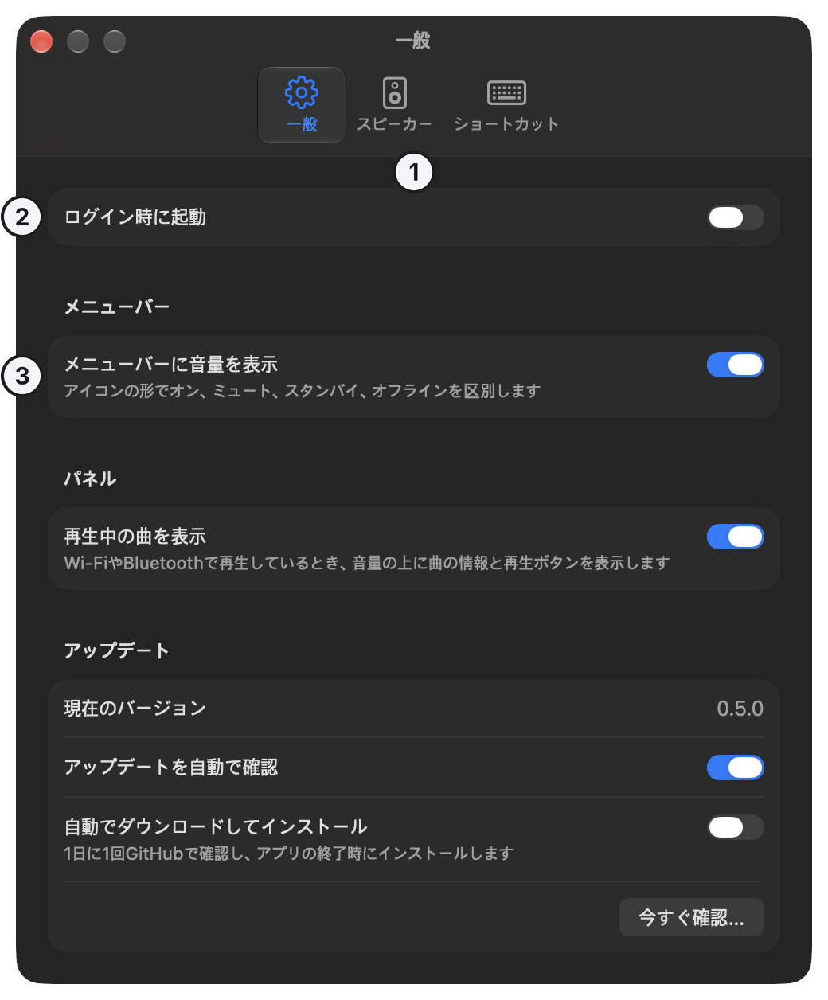

1. **タブ**: 一般、スピーカー、ショートカット
2. **ログイン時に起動**: 初めてオンにするとき、システム設定での許可が必要な場合があります。
3. **メニューバーに音量を表示**: 初期設定ではオンです。オフにするとアイコンだけになります。

同じタブの**アップデート**: **アップデートを自動で確認**をオンにしておくと1日に1回確認し、**自動でダウンロードしてインストール**もオンにすると、アプリの終了時にインストールします。**今すぐ確認…** ですぐに確認できます。アプリがメニューバーにある間に見つかったアップデートは、**インストール…** を押すまでパネルに1行で表示されます。

同じタブの**パネル → 再生中の曲を表示**: パネルの音量の上の曲のタイルをオン/オフします。

### 設定: スピーカー

スピーカーが1台のときのタブです。2台以上では一覧になり、行のⓘをクリックするとそのスピーカーの同じ内容が開きます（[複数のスピーカー](#複数のスピーカー)）。

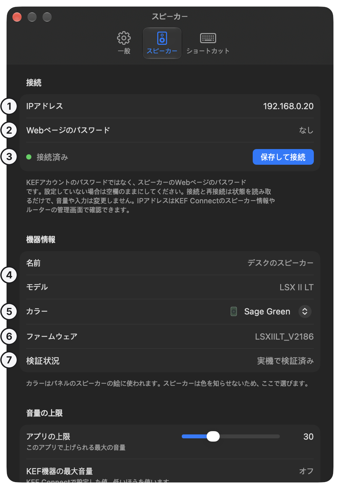

1. **IPアドレス**
2. **Webページのパスワード**: 設定していなければ空欄のままにします。キーチェーンに保存します。
3. **保存して接続**: 左に接続の状態が表示されます。
4. **名前とモデル**: 接続すると、スピーカーが返した値が表示されます。
5. **カラー**: パネルのスピーカーの絵の色です。一覧にはそのモデルのカラーだけが表示され、選ばない場合はアプリの既定色（LS60 Royal Blue）です。モデルごとの絵は[下](#スピーカーの絵)にあります。
6. **ファームウェア**
7. **検証状況**: 実際のスピーカーで確認したモデルかどうかを表示します。

下にスクロールすると、このスピーカーだけに適用される音量の設定が続きます。

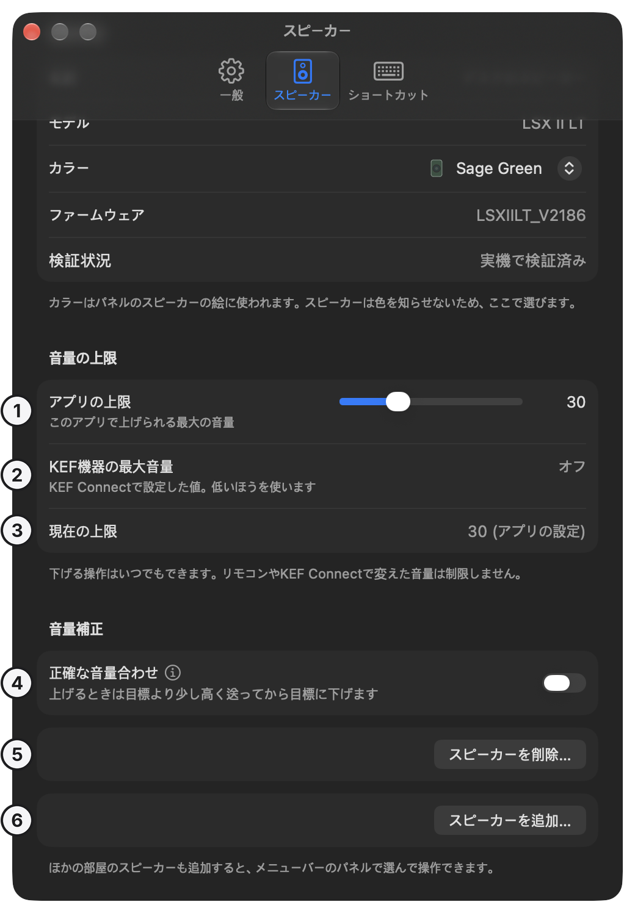

1. **アプリの上限**: スライダーで決めます。
2. **KEF機器の最大音量**
3. **現在の上限**
4. **正確な音量合わせ**: 名前の横のⓘをクリックすると、短い説明が出ます。
5. **スピーカーを削除…**: このMacの一覧から削除するだけで、スピーカー自体は変わりません。
6. **スピーカーを追加…**: ほかの部屋のスピーカーを追加します。

### 設定: ショートカット

- **音量を上げる**、**音量を下げる**、**ミュートのオン/オフ**: ボックスをクリックしてから新しい組み合わせを押すと変わります。<kbd>esc</kbd>でキャンセル、<kbd>delete</kbd>でオフになります。ファンクションキー（F1〜F20）以外は、<kbd>⌃</kbd>、<kbd>⌥</kbd>、<kbd>⌘</kbd>のいずれかと一緒に押す必要があります。
- **次のスピーカーに切り替える**: 初期設定ではオフです。組み合わせを決めておくと、スピーカーが2台以上のとき選択中のスピーカーを一覧の順に切り替えます。
- **デフォルトに戻す**: ショートカットを最初の組み合わせに戻します。
- **1回押したときの音量**: 1、2、3、5または**体感音量**。Windowsと同じです。
- **音量を変えたときに画面に表示**: オフでも接続の問題と上限は表示します。

## 複数のスピーカー

部屋ごとのKEFスピーカーを登録しておき、その中から1台を選んで操作します。1台だけなら、画面はこれまでと同じです。スピーカーは、設定の**スピーカー**画面の**スピーカーを追加**でIPアドレスを入力して追加します。

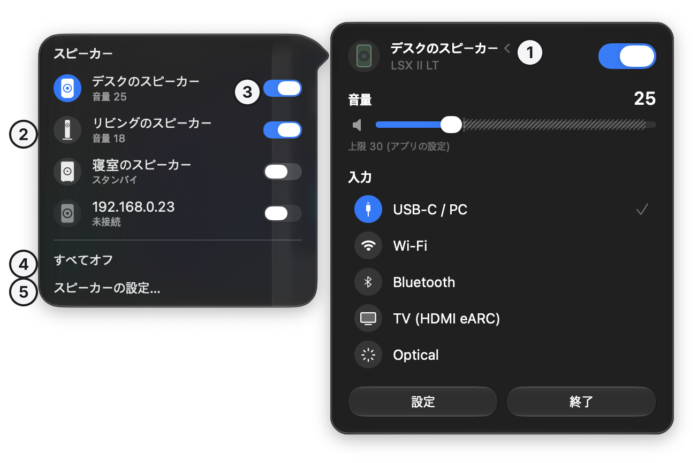

1. **スピーカーの名前**: 押すと横に一覧が開き、山かっこの向きが変わります。もう一度押すと閉じます。Windowsのフライアウトも同じです。
2. **スピーカーの行**: 押すとそのスピーカーに切り替わります。名前の下に音量、スタンバイ、未接続などの状態が表示されます。アプリを起動し直しても、最後に選んだスピーカーが選択されたままです。
3. **電源スイッチ**: 選ばなくても、そのスピーカーの電源を入れたり切ったりできます。
4. **すべてオフ**: 電源が入っているスピーカーをすべてスタンバイにします。Windowsでは**すべて切る**です。
5. **スピーカーの設定…**: 設定のスピーカー画面を開きます。Windowsでは**スピーカーの管理**です。

- **選択中のスピーカーに従うもの**: フライアウトとパネル、通知領域とメニューバーのアイコン、ショートカットと音量表示です。音量表示はどのスピーカーかも表示します（Windowsは名前、macOSはモデルの絵）。
- **スピーカーごとに設定するもの**: アドレス、パスワード、カラー、モデルの選択、アプリの上限、正確な音量合わせ。ショートカット、1回押したときの音量、音量表示、再生中の曲の表示、自動起動、アップデートはすべてのスピーカーで共通です。
- **次のスピーカーに切り替える**: 設定の**ショートカット**で組み合わせを決めておくと、一覧を開かずに選択中のスピーカーを一覧の順に切り替えます。初期設定ではオフです。

選択中のスピーカーだけが接続を保ち、変化をすぐに受け取ります。ほかのスピーカーは一覧が開いている間だけ数秒ごとに読み取るため、スピーカーが増えてもネットワークの使用量はほとんど変わりません。

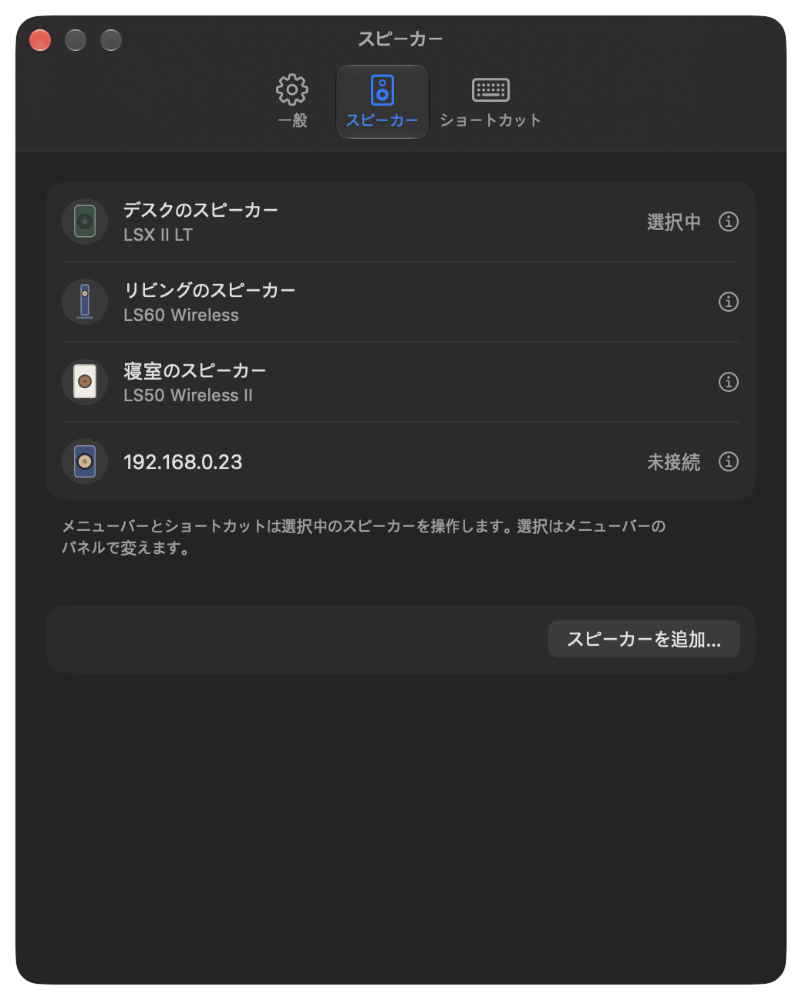

設定の**スピーカー**画面は、2台以上で一覧になります。行ごとにスピーカーの絵、名前、モデルと選択中かどうかが表示されます。Windowsは行を押すと、macOSはⓘをクリックすると、そのスピーカーの設定が開きます。内容は1台のときの[Windows](#設定-スピーカー)・[macOS](#設定-スピーカー-1)の画面と同じです。

## 音量の上限と正確な音量合わせ

### 音量の上限

上限は2つあり、どちらもスピーカーごとで、低いほうが適用されます。このアプリで決める**アプリの上限**と、KEF Connectで決める**KEF機器の最大音量**です。下げる操作はいつでもでき、リモコンやKEF Connectで変えた音量は制限しません。すでに上限より高い場合は、下げることだけができます。

### 正確な音量合わせ

KEFのスピーカーは一部の範囲で、下から上げた音量が同じ数値でも小さく聞こえます。この機能をオンにすると、音量を上げるときに少し高い値を先に送り、0.1秒後に目標の値を送るため、上から下げたときと同じ大きさで聞こえます。

- 20に上げると22を経由し、12に上げると17を経由します。
- 5以下と41以上はそのまま送ります。経由する値は上限を超えず、下げるときはそのまま送ります。

測定値は、[kef-lsx-volume](https://github.com/roberdorfer/kef-lsx-volume)がLSX II（USB入力）で測ったものです。LSX II LTではまだ確認していないため、初期設定ではオフです。

## スピーカーの絵

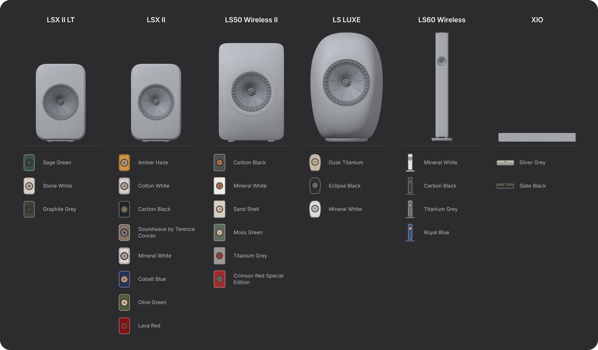

フライアウトとパネルの上部にあるスピーカーの絵は、モデルごとに形が変わります。上の段はKEFの3Dモデルを単色でレンダリングしたもので、下の段は小さく表示しても見分けられるように、アプリがそれを簡単な形に描き直したカラー別の絵です。ブックシェルフ型の4モデルは実際の大きさの比率のままで、LS60 WirelessとXIOは枠に合わせて縮小しています。

- カラーを選ぶと、そのカラーがあるモデルの形をそのカラーで描きます。
- カラーを選ばない場合は、認識したモデルの形をアプリの既定色（LS60 Royal Blue）で描きます。
- アプリが知らないモデルの場合は、絵に使うモデルを選べます。Windowsは設定の**スピーカー**画面の**スピーカーのモデル**、macOSは設定の**スピーカー**タブの**モデルを選択**です。選ぶまではアプリアイコンと同じ絵です。
- カラーの一覧にはそのモデルのカラーだけが表示され、モデルがわからない場合はアプリの既定色だけになります。モデルの選択は絵とカラーの一覧にだけ使われ、入力の一覧は変わりません。

## トラブルシューティング

- **接続できないとき**: スピーカーの電源とWi-Fiの接続を確認してください。PCやMacがスピーカーと同じネットワークにある必要があります。スピーカーのIPアドレスが変わった可能性もあります。macOSでは、**システム設定 → プライバシーとセキュリティ → ローカルネットワーク**でRemote for KEFがオンになっているか確認してください。接続が切れると、アプリは再接続を続けます。
- **Windowsで実行できないとき**: スマートアプリコントロールがオンだと、署名していないアプリは**実行**ボタンなしでブロックされます。このアプリだけを例外にはできないため、スマートアプリコントロールをオフにする必要があります。オフにする前に[Microsoftの説明](https://support.microsoft.com/ja-jp/topic/what-is-smart-app-control-285ea03d-fa88-4d56-882e-6698afdb7003)を確認してください。
- **ショートカットが効かないとき**: ほかのアプリが同じ組み合わせを使っている可能性があります。設定の**ショートカット**で別の組み合わせを選んでください。macOSでは、Mission Controlなどシステムが使う組み合わせは、設定済みに見えてもアプリまで届かないことがあります。
- **再生中の曲が表示されないとき**: 曲のカードとタイルは、Wi-FiとBluetoothの入力で曲を再生中または一時停止中で、設定の**再生中の曲を表示**がオンのときだけ表示されます。USBや光デジタルなどの有線入力は曲の情報を送りません。
- **アプリから電源を入れられないとき**: ネットワーク経由で電源を入れられない機器は、アプリがそう表示します。リモコンかKEF Connectで電源を入れてください。
- **そのほかの問題**: Windowsでは、設定の**バージョン情報 → 設定とログのフォルダー**に記録が残ります。[Issues](https://github.com/kimdaehee0824/Remote-for-KEF/issues)でお知らせください。
