# 使い方ガイド

[English](guide.md) · [한국어](guide_ko.md) · 日本語

Remote for KEFの画面を順に説明します。写真の番号と、その下の一覧の番号は同じです。

- [はじめに](#はじめに)
- [Windows](#windows)
- [macOS](#macos)
- [音量の上限と正確な音量合わせ](#音量の上限と正確な音量合わせ)
- [トラブルシューティング](#トラブルシューティング)

## はじめに

### インストール

- **Windows**: zipを展開して`RemoteForKEF.exe`を実行します。署名していないアプリのため、SmartScreenが表示されたら**詳細情報 → 実行**を選びます。ダウンロードフォルダーではなく、置いておくフォルダーに移してから実行するのがおすすめです。
- **macOS**: zipを展開して**Remote for KEF**をアプリケーションフォルダーに移し、開きます。開けないと表示されたら、**システム設定 → プライバシーとセキュリティ**で**このまま開く**をクリックします。ローカルネットワークへのアクセスを求められたら許可してください。許可しないとスピーカーに接続できません。

### スピーカーの接続

1. スピーカーのIPアドレスを確認します。KEF Connectアプリのスピーカー情報や、ルーターの管理画面で確認できます。ルーターでこのスピーカーに固定IPを割り当てておくと、アドレスが変わりません。
2. 設定の**スピーカー**画面にIPアドレスを入力して接続します。画面は[Windows](#設定-スピーカー)と[macOS](#設定-スピーカー-1)にあります。
3. KEF Connectで機器のパスワードを設定した場合だけ、パスワードも入力します。KEFアカウントのパスワードではありません。

接続ではスピーカーの状態を読むだけで、音量や入力は変えません。

## Windows

### フライアウト

タスクバーの通知領域のアイコンをクリックすると開きます。アイコンが見当たらない場合は、タスクバーの^の中を見てください。

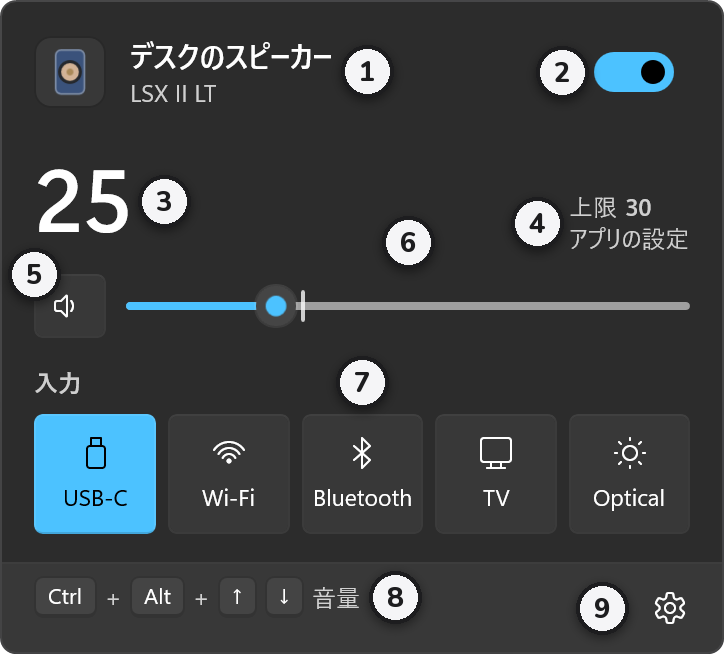

1. **スピーカーの名前とモデル**
2. **電源**: オフにするとスピーカーがスタンバイになります。
3. **音量**: スピーカーが返した実際の値です。
4. **上限**: 現在の上限と、それがアプリの設定かKEF機器の設定かを表示します。
5. **ミュート**: 押すたびにミュートと解除が切り替わります。
6. **音量スライダー**: 1刻みで動きます。縦の目盛りが上限で、それより上には上がりません。
7. **入力**: 押すとその入力に切り替わります。切り替え中は一時的にミュートし、新しい入力の音量が前より高くなく上限の範囲内のときだけミュートを解除します。
8. **ショートカットの案内**: 音量を上げ下げするショートカットです。
9. **設定と終了**: 設定、バージョン情報、終了があります。

### スタンバイから電源を入れる

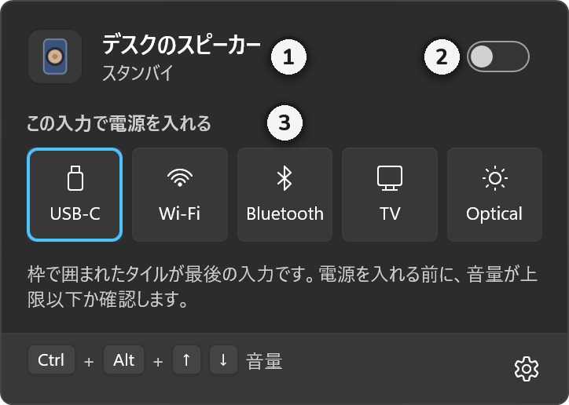

1. 名前の下に**スタンバイ**と表示されます。
2. **電源**をオンにすると、最後の入力で電源が入ります。
3. 入力を押すと、その入力ですぐに電源が入ります。枠のあるタイルが最後の入力です。

電源を入れる前に、音量が上限の範囲内かを確認します。スタンバイ前の音量が上限より高い場合は電源を入れず、理由を表示します。

### ミュート中

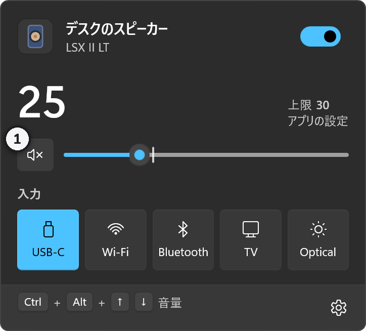

1. ミュート中はボタンのスピーカーに×が付きます。もう一度押すと解除されます。

### ショートカットと音量表示

<!-- W4 -->

- どのアプリからでも<kbd>Ctrl</kbd>+<kbd>Alt</kbd>+<kbd>↑</kbd> / <kbd>↓</kbd>で音量を、<kbd>Ctrl</kbd>+<kbd>Alt</kbd>+<kbd>M</kbd>でミュートを切り替えます。
- 音量が変わると、画面の右下に音量表示が少しの間出ます。その上でマウスホイールを回しても音量が変わります。
- ほかのアプリが同じ組み合わせを使っていると、フライアウトの下に**ショートカットを確認**と表示されます。VS Code、JetBrains IDE、Visual Studio、Wordも一部を使っているため、重なる場合は設定の**ショートカット**で変えてください。

### 設定: 一般

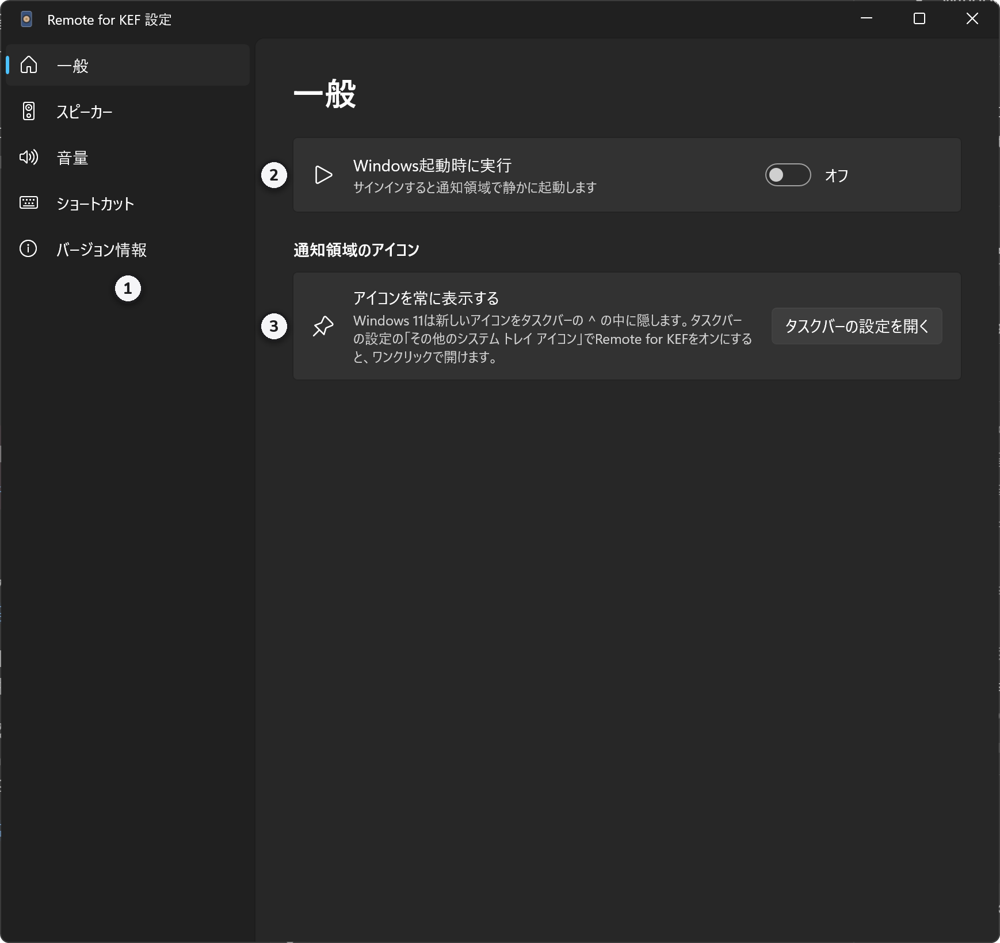

1. **メニュー**: 一般、スピーカー、音量、ショートカット、バージョン情報の画面に移ります。
2. **Windows起動時に実行**: サインインすると通知領域で静かに起動します。
3. **アイコンを常に表示する**: Windows 11は新しいアイコンを^の中に隠します。**タスクバーの設定を開く**からRemote for KEFをオンにしておくと、1回のクリックで開けます。

### 設定: スピーカー

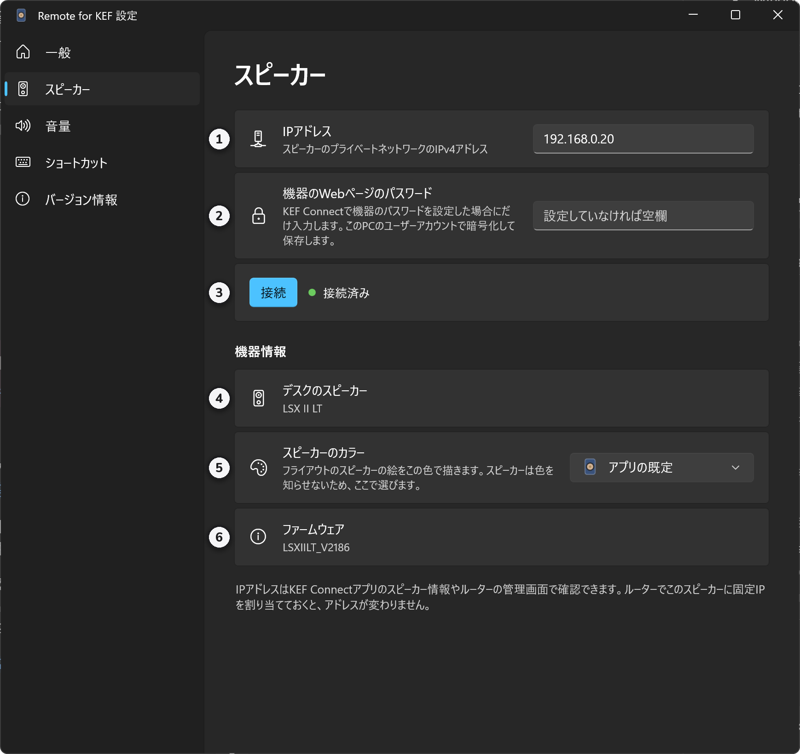

1. **IPアドレス**
2. **機器のWebページのパスワード**: 設定していなければ空欄のままにします。このPCのユーザーアカウントで暗号化して保存します。
3. **接続**: 横に接続の状態が表示されます。
4. **機器の名前とモデル**: 接続すると、スピーカーが返した値が表示されます。
5. **スピーカーのカラー**: スピーカーは自分の色を知らせないため、ここで選びます。フライアウトのスピーカーの絵がこの色になります。初期設定はLS60 Royal Blueです。
6. **ファームウェア**

### 設定: 音量

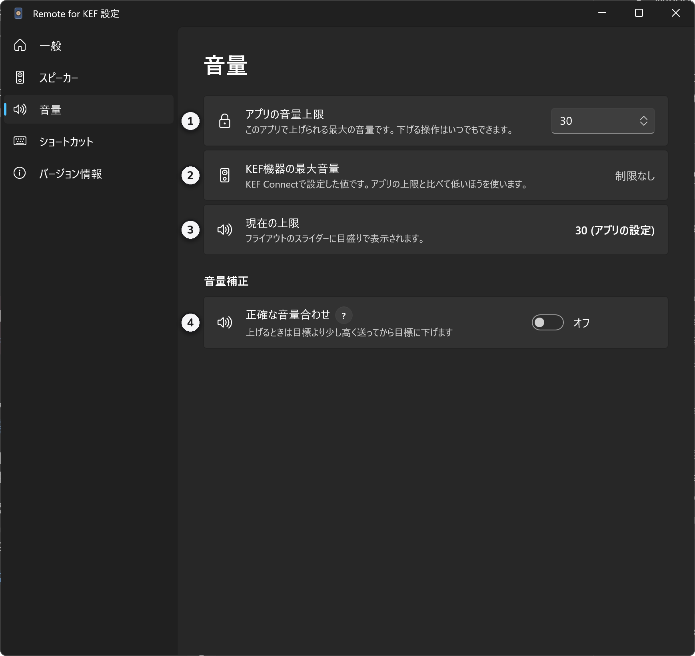

1. **アプリの音量上限**: このアプリで上げられる最大の音量です。
2. **KEF機器の最大音量**: KEF Connectで設定した値です。
3. **現在の上限**: 2つのうち低いほうです。フライアウトのスライダーの目盛りがこの値です。
4. **正確な音量合わせ**: **?** ボタンを押すと短い説明が出ます。詳しくは[下](#正確な音量合わせ)で説明します。

### 設定: ショートカット

<!-- W8 -->

1. **ショートカットの一覧**: 枠をクリックして新しい組み合わせを押すと変わります。<kbd>Esc</kbd>で取り消し、<kbd>Backspace</kbd>でオフにします。
2. **1回押したときの音量**: 1、2、3、5、または**体感音量**。ショートカットと音量表示のマウスホイールに適用されます。
3. **音量を変えたときに画面の右下に表示**: オフにしても、接続の問題や上限などのエラーは表示します。
4. **既定値に戻す**

**体感音量**は、同じ数ずつ足す代わりに、聞こえる大きさが均等に増えるように測った段階（12、15、19、22、25、29 …）に従います。65より上では4ずつ動き、12より下では上げると12、下げると0になります。

## macOS

### メニューバーのアイコン

アイコンの形でスピーカーの状態がわかります。アイコンをクリックするとパネルが開きます。

1. **オン**: 横の数字は現在の音量です。
2. **ミュート**
3. **スタンバイ**
4. **数字をオフにした場合**: 設定の**メニューバーに音量を表示**をオフにすると、アイコンだけになります。

接続が切れると、アイコンの形がもう一度変わります。

### パネル

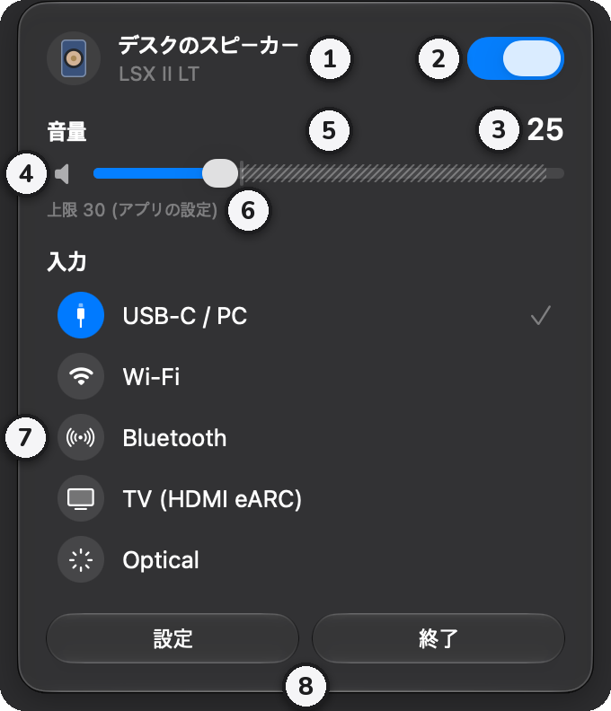

1. **スピーカーの名前とモデル**
2. **電源**: オフにするとスタンバイになります。
3. **音量**: スピーカーが返した実際の値です。
4. **ミュート**: スピーカーのアイコンをクリックすると、ミュートと解除が切り替わります。
5. **音量スライダー**: 斜線の部分は上限より上なので、上がりません。
6. **上限**: 現在の上限と、その設定元です。
7. **入力**: クリックするとその入力に切り替わります。チェックマークが現在の入力です。切り替え方はWindowsと同じです。
8. **設定**と**終了**

### スタンバイから電源を入れる

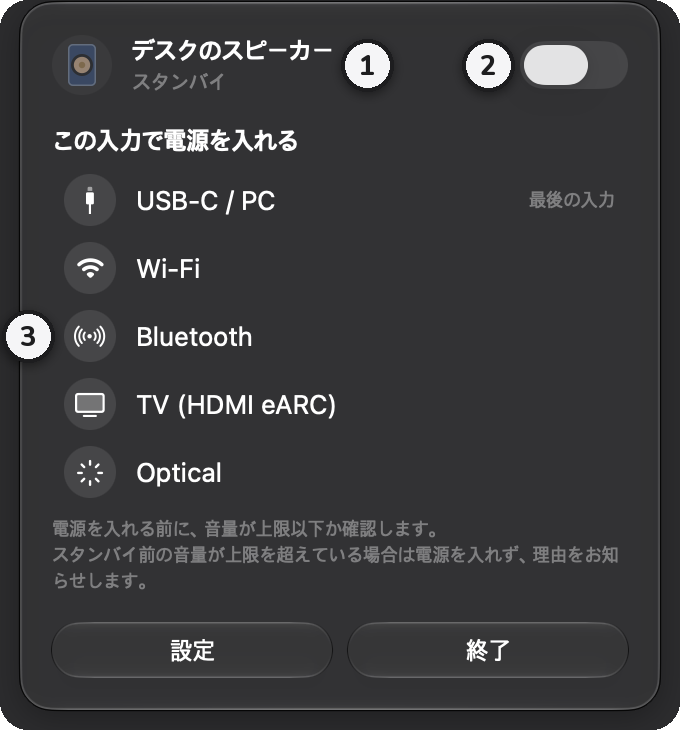

1. 名前の下に**スタンバイ**と表示されます。
2. **電源**をオンにすると、最後の入力で電源が入ります。
3. 入力をクリックすると、その入力ですぐに電源が入ります。**最後の入力**と書かれているのが最後の入力です。

### ミュート中

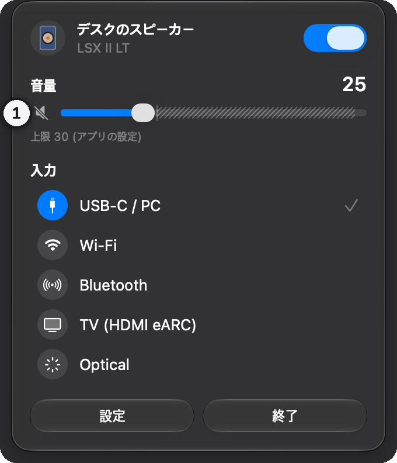

1. ミュート中はスピーカーのアイコンに斜線が入ります。もう一度クリックすると解除されます。

### 設定: 一般

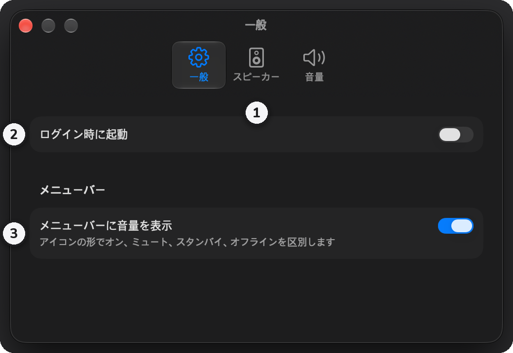

1. **タブ**: 一般、スピーカー、音量
2. **ログイン時に起動**: 初めてオンにするとき、システム設定での許可が必要な場合があります。
3. **メニューバーに音量を表示**: 初期設定ではオンです。オフにするとアイコンだけになります。

### 設定: スピーカー

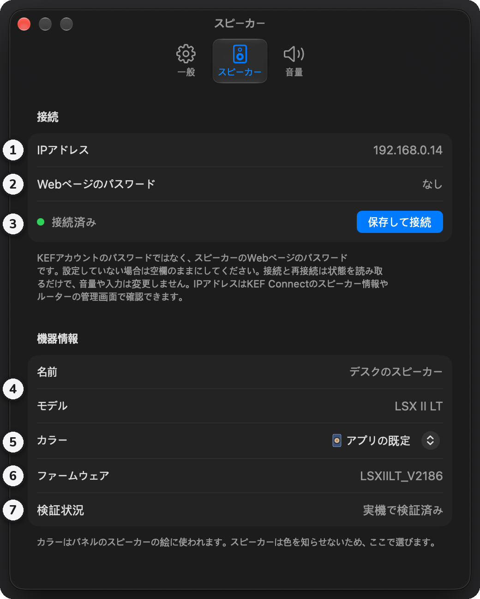

1. **IPアドレス**
2. **Webページのパスワード**: 設定していなければ空欄のままにします。キーチェーンに保存します。
3. **保存して接続**: 左に接続の状態が表示されます。
4. **名前とモデル**: 接続すると、スピーカーが返した値が表示されます。
5. **カラー**: パネルのスピーカーの絵の色です。初期設定はLS60 Royal Blueです。
6. **ファームウェア**
7. **検証状況**: 実際のスピーカーで確認したモデルかどうかを表示します。

### 設定: 音量

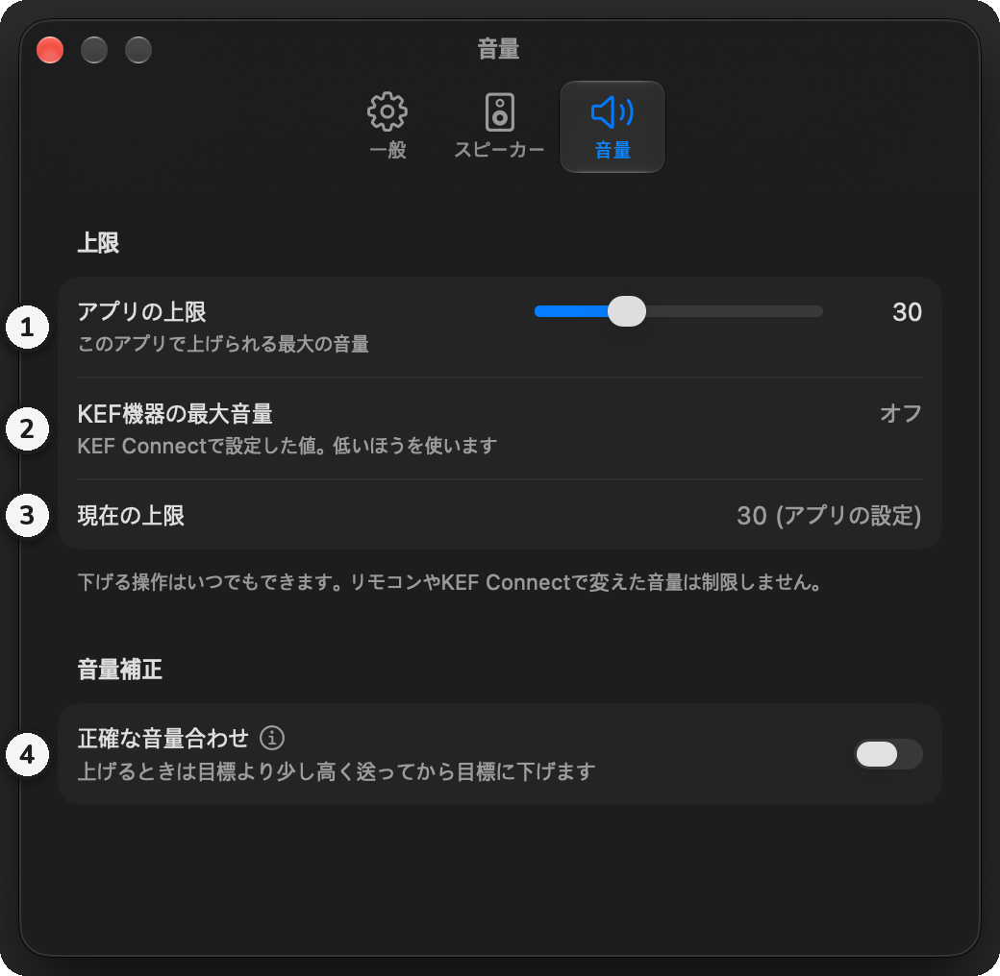

1. **アプリの上限**: スライダーで決めます。
2. **KEF機器の最大音量**
3. **現在の上限**
4. **正確な音量合わせ**: 名前の横のⓘをクリックすると、短い説明が出ます。

## 音量の上限と正確な音量合わせ

### 音量の上限

上限は2つあり、低いほうが適用されます。このアプリで決める**アプリの上限**と、KEF Connectで決める**KEF機器の最大音量**です。下げる操作はいつでもでき、リモコンやKEF Connectで変えた音量は制限しません。すでに上限より高い場合は、下げることだけができます。

### 正確な音量合わせ

KEFのスピーカーは一部の範囲で、下から上げた音量が同じ数値でも小さく聞こえます。この機能をオンにすると、音量を上げるときに少し高い値を先に送り、0.1秒後に目標の値を送るため、上から下げたときと同じ大きさで聞こえます。

- 20に上げると22を経由し、12に上げると17を経由します。
- 5以下と41以上はそのまま送ります。経由する値は上限を超えず、下げるときはそのまま送ります。

測定値は、[kef-lsx-volume](https://github.com/roberdorfer/kef-lsx-volume)がLSX II（USB入力）で測ったものです。LSX II LTではまだ確認していないため、初期設定ではオフです。

## トラブルシューティング

- **接続できないとき**: スピーカーの電源とWi-Fiの接続を確認してください。PCやMacがスピーカーと同じネットワークにある必要があります。スピーカーのIPアドレスが変わった可能性もあります。macOSでは、**システム設定 → プライバシーとセキュリティ → ローカルネットワーク**でRemote for KEFがオンになっているか確認してください。接続が切れると、アプリは再接続を続けます。
- **Windowsで実行できないとき**: スマートアプリコントロールがオンだと、署名していないアプリは**実行**ボタンなしでブロックされます。このアプリだけを例外にはできないため、スマートアプリコントロールをオフにする必要があります。オフにする前に[Microsoftの説明](https://support.microsoft.com/ja-jp/topic/what-is-smart-app-control-285ea03d-fa88-4d56-882e-6698afdb7003)を確認してください。
- **ショートカットが効かないとき**: ほかのアプリが同じ組み合わせを使っている可能性があります。設定の**ショートカット**で別の組み合わせを選んでください。
- **アプリから電源を入れられないとき**: ネットワーク経由で電源を入れられない機器は、アプリがそう表示します。リモコンかKEF Connectで電源を入れてください。
- **そのほかの問題**: Windowsでは、設定の**バージョン情報 → 設定とログのフォルダー**に記録が残ります。[Issues](https://github.com/kimdaehee0824/Remote-for-KEF/issues)でお知らせください。
