# 사용 설명서

[English](guide.md) · 한국어 · [日本語](guide_jp.md)

Remote for KEF의 화면을 하나씩 살펴봅니다. 사진의 번호와 아래 목록의 번호가 같습니다.

- [시작하기](#시작하기)
- [Windows](#windows)
- [macOS](#macos)
- [음량 상한과 정확한 음량 맞추기](#음량-상한과-정확한-음량-맞추기)
- [문제 해결](#문제-해결)

## 시작하기

### 설치

- **Windows**: zip을 풀고 `RemoteForKEF.exe`를 실행합니다. 서명하지 않은 앱이라 SmartScreen이 뜨면 **추가 정보 → 실행**을 누르세요. 다운로드 폴더보다는 계속 둘 폴더로 옮긴 뒤 실행하는 것이 좋습니다.
- **macOS**: zip을 풀고 **Remote for KEF**를 응용 프로그램 폴더로 옮긴 뒤 엽니다. 처음에 열 수 없다고 나오면 **시스템 설정 → 개인정보 보호 및 보안**에서 **그래도 열기**를 누르세요. 로컬 네트워크 접근을 물으면 허용해야 스피커에 연결됩니다.

### 스피커 연결

1. 스피커의 IP 주소를 확인합니다. KEF Connect 앱의 스피커 정보나 공유기 관리 페이지에서 볼 수 있습니다. 공유기에서 이 스피커에 고정 IP를 예약해 두면 주소가 바뀌지 않습니다.
2. 설정의 **스피커** 화면에 IP 주소를 넣고 연결합니다. 화면은 [Windows](#설정-스피커)와 [macOS](#설정-스피커-1)에서 볼 수 있습니다.
3. KEF Connect에서 기기 암호를 정한 경우에만 암호를 함께 넣습니다. KEF 계정 암호가 아닙니다.

연결할 때는 스피커 상태를 읽기만 하고, 음량이나 입력은 바꾸지 않습니다.

## Windows

### 플라이아웃

작업 표시줄 알림 영역의 아이콘을 누르면 열립니다. 아이콘이 보이지 않으면 작업 표시줄의 ^ 안을 보세요.

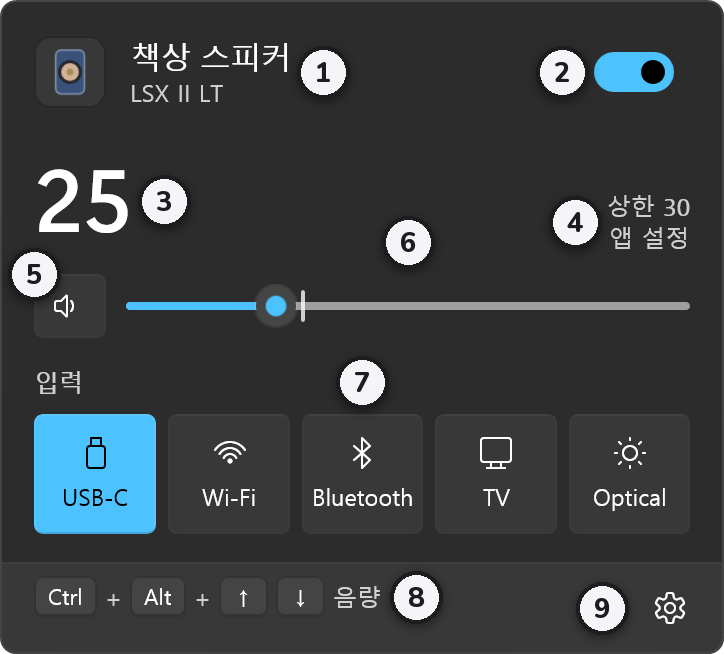

1. **스피커 이름과 모델**
2. **전원**: 끄면 스피커가 대기 상태가 됩니다.
3. **음량**: 스피커가 알려 준 실제 값입니다.
4. **상한**: 지금 적용되는 상한과, 그 값이 앱 설정인지 KEF 기기 설정인지 보여 줍니다.
5. **음소거**: 누를 때마다 음소거와 해제가 바뀝니다.
6. **음량 슬라이더**: 1 단위로 움직입니다. 세로 눈금이 상한이고, 그보다 높게는 올라가지 않습니다.
7. **입력**: 누르면 그 입력으로 바뀝니다. 바꾸는 동안 잠깐 음소거하고, 새 입력의 음량이 전보다 크지 않고 상한 안일 때만 음소거를 풉니다.
8. **단축키 안내**: 음량을 올리고 내리는 단축키입니다.
9. **설정**: 설정, 정보, 종료가 있습니다.

### 대기 상태에서 켜기

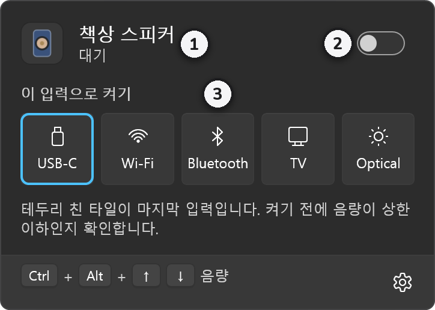

1. 이름 아래에 **대기**가 보입니다.
2. **전원**을 켜면 마지막 입력으로 켜집니다.
3. 입력을 누르면 그 입력으로 바로 켜집니다. 테두리가 있는 타일이 마지막 입력입니다.

켜기 전에 음량이 상한 안에 있는지 확인합니다. 대기 전 음량이 상한보다 높으면 켜지 않고 이유를 알려 줍니다.

### 음소거 상태

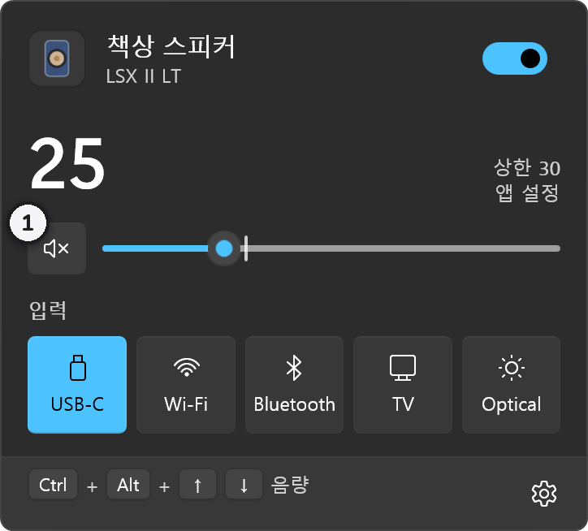

1. 음소거 중에는 버튼의 스피커에 × 표시가 붙습니다. 다시 누르면 풀립니다.

### 단축키와 음량 표시창

어느 앱에서든 <kbd>Ctrl</kbd>+<kbd>Alt</kbd>+<kbd>↑</kbd> / <kbd>↓</kbd>로 음량을, <kbd>Ctrl</kbd>+<kbd>Alt</kbd>+<kbd>M</kbd>으로 음소거를 바꿉니다. 음량이 바뀌면 마우스 포인터가 있는 모니터의 오른쪽 아래에 표시창이 잠깐 나타납니다.

1. **스피커 아이콘**: 누르면 음소거와 해제가 바뀝니다.
2. **음량 막대**: 세로 눈금이 상한입니다. 표시창 위에서 마우스 휠을 굴려도 음량이 바뀝니다.
3. **현재 음량**

다른 앱이 같은 조합을 쓰고 있으면 플라이아웃 아래에 **단축키 확인 필요**가 보입니다. VS Code, JetBrains IDE, Visual Studio, Word도 이 조합 일부를 쓰니, 겹치면 설정의 **단축키**에서 바꾸세요.

### 설정: 일반

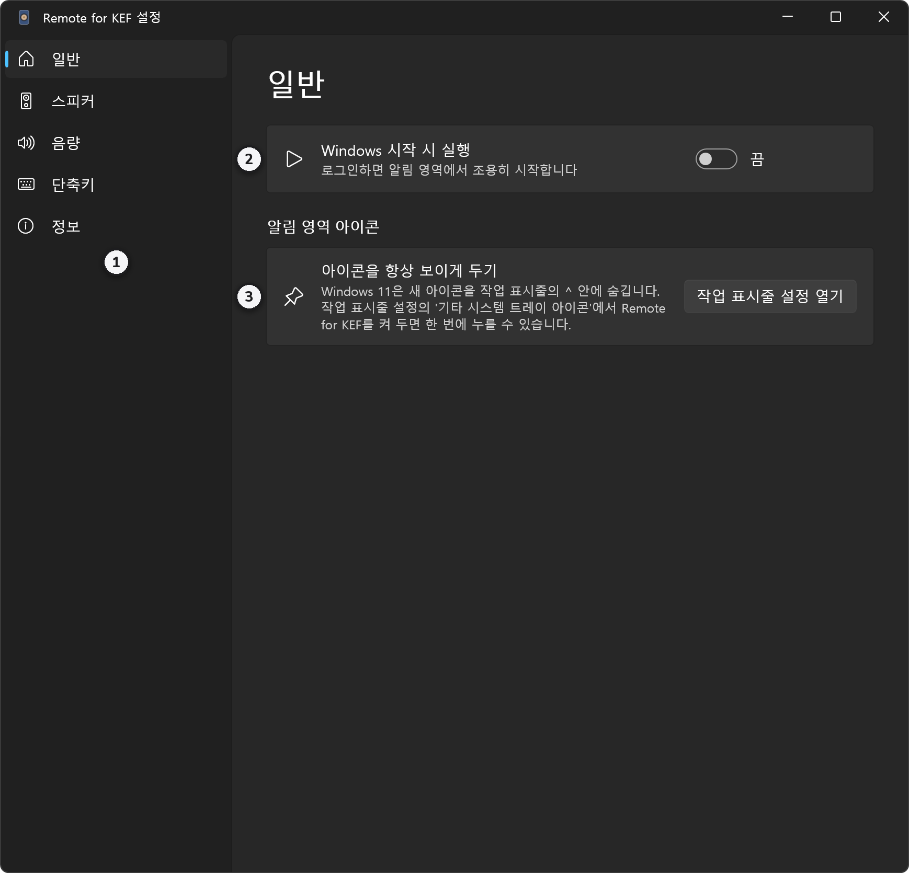

1. **메뉴**: 일반, 스피커, 음량, 단축키, 정보 화면으로 옮겨 갑니다.
2. **Windows 시작 시 실행**: 로그인하면 알림 영역에서 조용히 시작합니다.
3. **아이콘을 항상 보이게 두기**: Windows 11은 새 아이콘을 ^ 안에 숨깁니다. **작업 표시줄 설정 열기**를 눌러 Remote for KEF를 켜 두면 한 번에 열 수 있습니다.

### 설정: 스피커

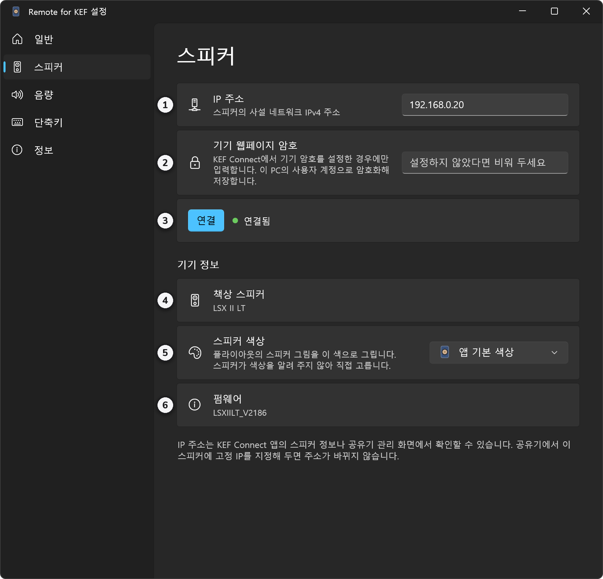

1. **IP 주소**
2. **기기 웹페이지 암호**: 정하지 않았다면 비워 둡니다. 이 PC의 사용자 계정으로 암호화해 저장합니다.
3. **연결**: 옆에 연결 상태가 보입니다.
4. **기기 이름과 모델**: 연결되면 스피커가 알려 준 값이 보입니다.
5. **스피커 색상**: 스피커는 자기 색을 알려 주지 않아 여기서 고릅니다. 플라이아웃의 스피커 그림이 이 색으로 바뀝니다. 기본은 LS60 Royal Blue입니다.
6. **펌웨어**

### 설정: 음량

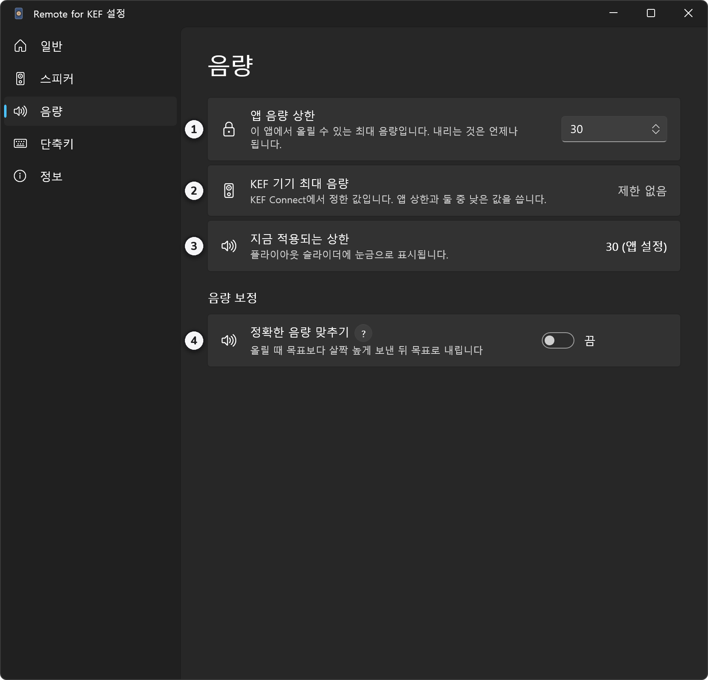

1. **앱 음량 상한**: 이 앱으로 올릴 수 있는 최대 음량입니다.
2. **KEF 기기 최대 음량**: KEF Connect에서 정한 값입니다.
3. **지금 적용되는 상한**: 둘 중 낮은 값입니다. 플라이아웃 슬라이더의 눈금이 이 값입니다.
4. **정확한 음량 맞추기**: **?** 버튼을 누르면 짧은 설명이 나옵니다. 자세한 내용은 [아래](#정확한-음량-맞추기)에 있습니다.

### 설정: 단축키

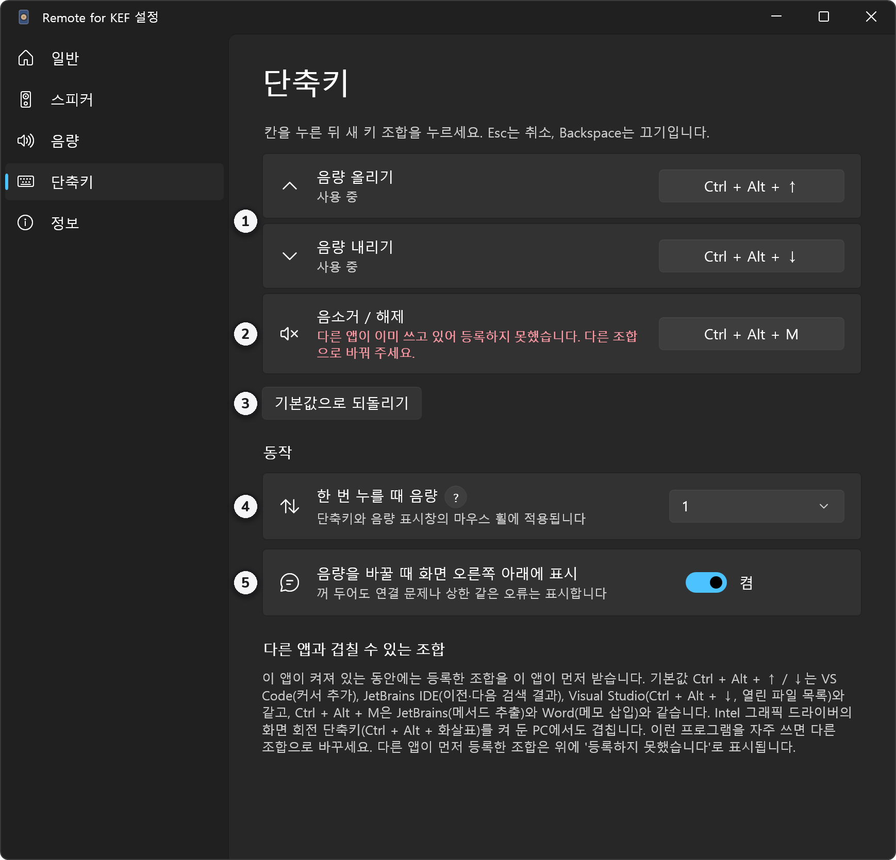

1. **음량 올리기**, **음량 내리기**: 칸을 누르고 새 조합을 누르면 바뀝니다. <kbd>Esc</kbd>는 취소, <kbd>Backspace</kbd>는 끄기입니다.
2. **음소거 / 해제**: 사진은 다른 앱이 <kbd>Ctrl</kbd>+<kbd>Alt</kbd>+<kbd>M</kbd>을 먼저 쓰고 있을 때의 모습입니다. 이렇게 빨간 글씨가 보이면 다른 조합으로 바꾸세요.
3. **기본값으로 되돌리기**: 세 단축키를 처음 조합으로 되돌립니다.
4. **한 번 누를 때 음량**: 1, 2, 3, 5 또는 **체감 음량 기준**. 단축키와 표시창의 마우스 휠에 함께 적용됩니다.
5. **음량을 바꿀 때 화면 오른쪽 아래에 표시**: 꺼 두어도 연결 문제나 상한 같은 오류는 표시합니다.

**체감 음량 기준**은 같은 숫자씩 더하는 대신 소리 크기가 고르게 늘도록 미리 잰 단계(12, 15, 19, 22, 25, 29 …)를 따릅니다. 65 위에서는 4씩 움직이고, 12 아래에서는 올리면 12, 내리면 0으로 갑니다.

## macOS

### 메뉴 막대 아이콘

아이콘 모양으로 스피커 상태를 알 수 있습니다. 아이콘을 누르면 패널이 열립니다.

1. **켜짐**: 옆의 숫자는 지금 음량입니다.
2. **음소거**
3. **대기**
4. **숫자를 끈 경우**: 설정의 **메뉴 막대에 음량 숫자 표시**를 끄면 아이콘만 남습니다.

연결이 끊기면 아이콘 모양이 한 번 더 바뀝니다.

### 패널

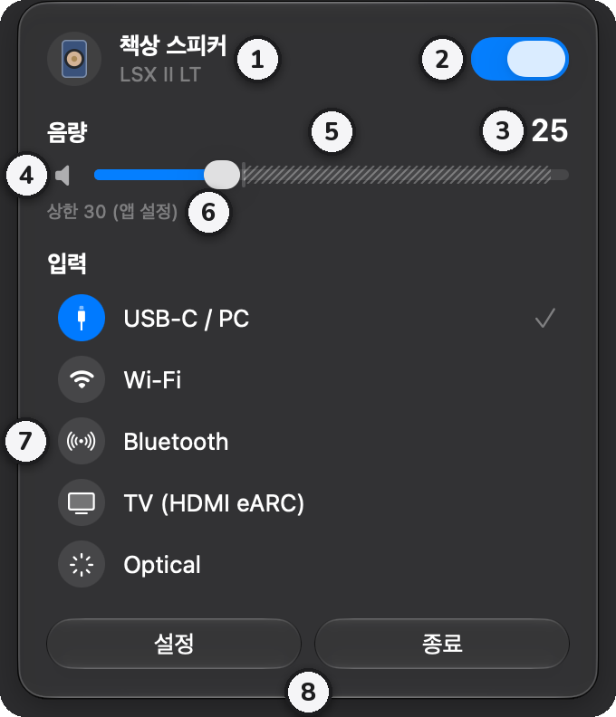

1. **스피커 이름과 모델**
2. **전원**: 끄면 대기 상태가 됩니다.
3. **음량**: 스피커가 알려 준 실제 값입니다.
4. **음소거**: 스피커 아이콘을 누르면 음소거와 해제가 바뀝니다.
5. **음량 슬라이더**: 빗금 부분은 상한보다 높은 구간이라 올라가지 않습니다.
6. **상한**: 지금 적용되는 상한과 그 출처입니다.
7. **입력**: 누르면 그 입력으로 바뀝니다. 체크 표시가 지금 입력입니다. 바꾸는 방식은 Windows와 같습니다.
8. **설정**과 **종료**

### 대기 상태에서 켜기

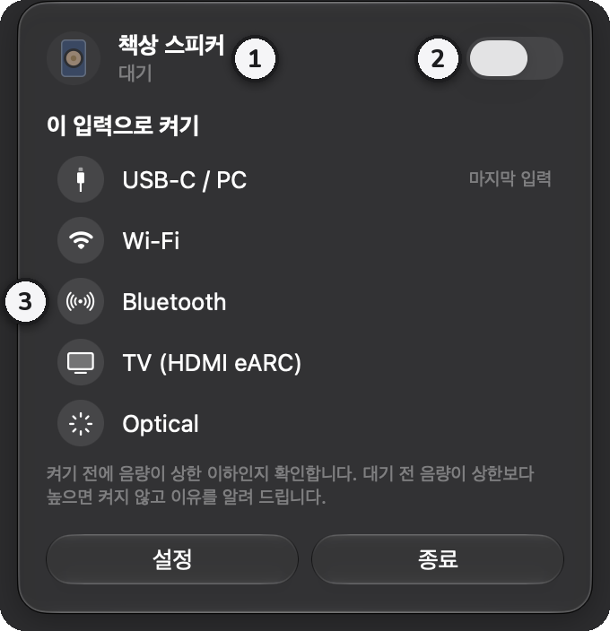

1. 이름 아래에 **대기**가 보입니다.
2. **전원**을 켜면 마지막 입력으로 켜집니다.
3. 입력을 누르면 그 입력으로 바로 켜집니다. **마지막 입력**이라고 적힌 것이 마지막 입력입니다.

### 음소거 상태

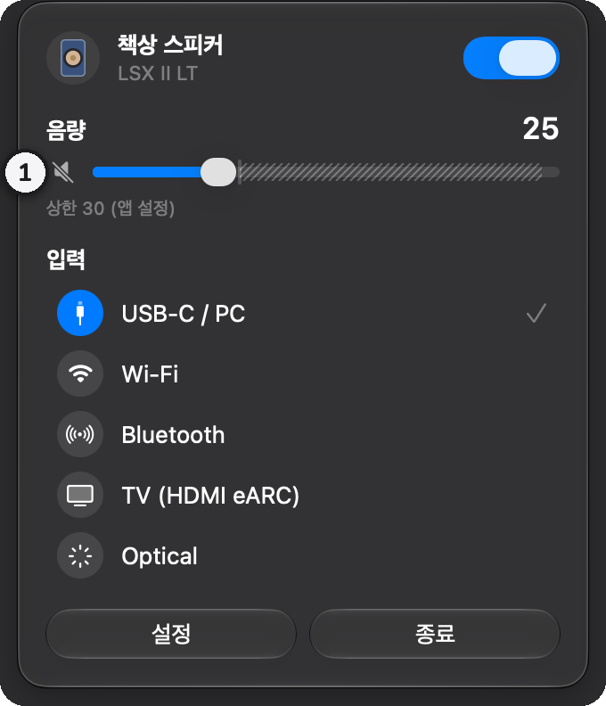

1. 음소거 중에는 스피커 아이콘에 사선이 그어집니다. 다시 누르면 풀립니다.

### 설정: 일반

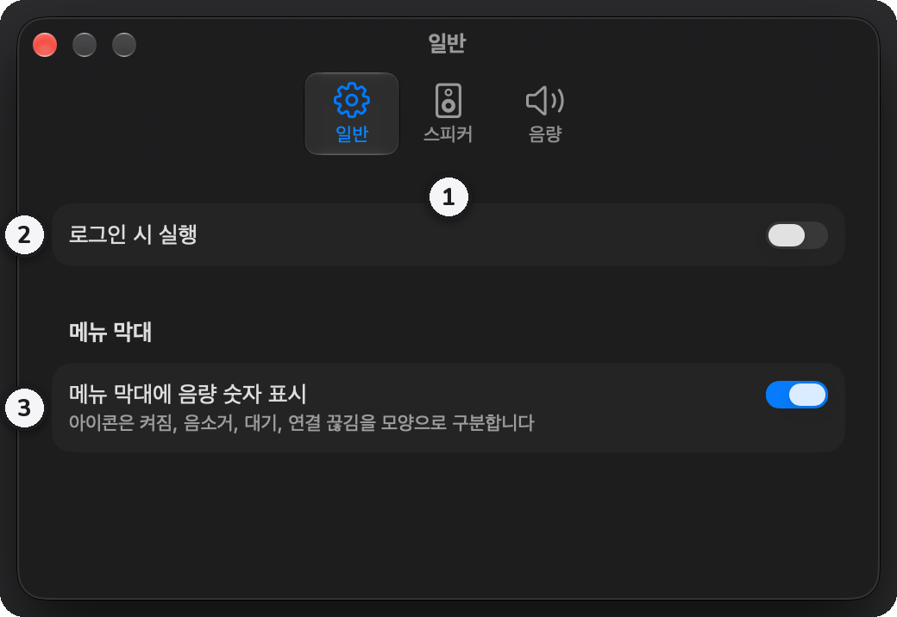

1. **탭**: 일반, 스피커, 음량
2. **로그인 시 실행**: 처음 켤 때 시스템 설정에서 승인이 필요할 수 있습니다.
3. **메뉴 막대에 음량 숫자 표시**: 기본으로 켜져 있습니다. 끄면 아이콘만 남습니다.

### 설정: 스피커

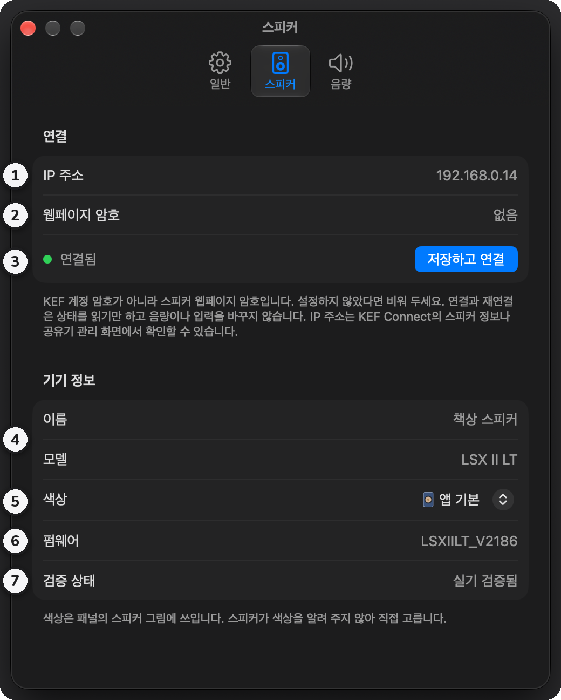

1. **IP 주소**
2. **웹페이지 암호**: 정하지 않았다면 비워 둡니다. 키체인에 저장합니다.
3. **저장하고 연결**: 왼쪽에 연결 상태가 보입니다.
4. **이름과 모델**: 연결되면 스피커가 알려 준 값이 보입니다.
5. **색상**: 패널의 스피커 그림 색입니다. 기본은 LS60 Royal Blue입니다.
6. **펌웨어**
7. **검증 상태**: 실제 스피커로 확인한 모델인지 보여 줍니다.

### 설정: 음량

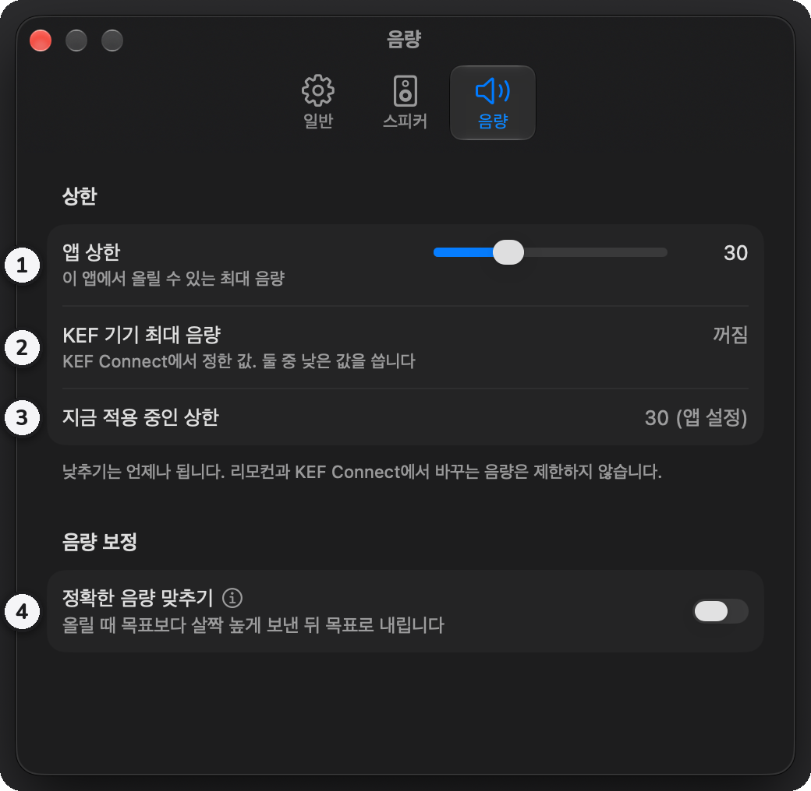

1. **앱 상한**: 슬라이더로 정합니다.
2. **KEF 기기 최대 음량**
3. **지금 적용 중인 상한**
4. **정확한 음량 맞추기**: 이름 옆의 ⓘ를 누르면 짧은 설명이 나옵니다.

## 음량 상한과 정확한 음량 맞추기

### 음량 상한

상한은 두 가지이고, 낮은 쪽이 적용됩니다. 이 앱에서 정하는 **앱 상한**과, KEF Connect에서 정하는 **KEF 기기 최대 음량**입니다. 내리는 것은 언제나 되고, 리모컨이나 KEF Connect로 바꾼 음량은 제한하지 않습니다. 이미 상한보다 높으면 내리기만 할 수 있습니다.

### 정확한 음량 맞추기

KEF 스피커는 일부 구간에서, 아래에서 올라온 음량이 같은 숫자인데도 더 작게 들립니다. 이 기능을 켜면 음량을 올릴 때 조금 높은 값을 먼저 보내고 0.1초 뒤 목표 값을 보내서, 위에서 내려온 것과 같은 크기로 들리게 합니다.

- 20으로 올리면 22를 거치고, 12로 올리면 17을 거칩니다.
- 5 이하와 41 이상은 바로 보냅니다. 중간 값은 상한을 넘지 않고, 내릴 때는 그대로 보냅니다.

측정값은 [kef-lsx-volume](https://github.com/roberdorfer/kef-lsx-volume)이 LSX II(USB 입력)에서 잰 것입니다. LSX II LT에서는 아직 확인하지 않아 기본으로 꺼져 있습니다.

## 문제 해결

- **연결되지 않을 때**: 스피커 전원과 Wi-Fi 연결을 확인하세요. PC나 Mac이 스피커와 같은 네트워크에 있어야 합니다. 스피커의 IP 주소가 바뀌었을 수도 있습니다. macOS에서는 **시스템 설정 → 개인정보 보호 및 보안 → 로컬 네트워크**에서 Remote for KEF가 켜져 있는지 확인하세요. 앱은 연결이 끊기면 계속 다시 시도합니다.
- **Windows에서 실행이 막힐 때**: 스마트 앱 컨트롤이 켜져 있으면 서명하지 않은 앱은 **실행** 버튼 없이 막힙니다. 이 앱만 예외로 둘 수는 없고, 스마트 앱 컨트롤을 꺼야 실행됩니다. 끄기 전에 [Microsoft 안내](https://support.microsoft.com/ko-kr/topic/what-is-smart-app-control-285ea03d-fa88-4d56-882e-6698afdb7003)를 확인하세요.
- **단축키가 듣지 않을 때**: 다른 앱이 같은 조합을 쓰고 있을 수 있습니다. 설정의 **단축키**에서 다른 조합을 고르세요.
- **앱에서 켜지지 않을 때**: 네트워크로 켤 수 없는 기기는 앱이 알려 줍니다. 리모컨이나 KEF Connect로 켜세요.
- **그 밖의 문제**: Windows는 설정의 **정보 → 설정과 로그 폴더**에 기록이 남습니다. [Issues](https://github.com/kimdaehee0824/Remote-for-KEF/issues)에 알려 주시면 확인하겠습니다.
