# 사용 설명서

[English](guide.md) · 한국어 · [日本語](guide_jp.md)

Remote for KEF의 화면을 하나씩 살펴봅니다. 사진의 번호와 아래 목록의 번호가 같습니다.

- [시작하기](#시작하기)
- [Windows](#windows)
- [macOS](#macos)
- [여러 스피커](#여러-스피커)
- [음량 상한과 정확한 음량 맞추기](#음량-상한과-정확한-음량-맞추기)
- [스피커 그림](#스피커-그림)
- [문제 해결](#문제-해결)

## 시작하기

### 설치

- **Windows**: `RemoteForKEF-win-x64-Setup.exe`를 실행합니다(ARM PC는 `-arm64-`). 서명하지 않은 앱이라 SmartScreen이 뜨면 **추가 정보 → 실행**을 누르세요. 관리자 권한 없이 내 계정에 설치되고 시작 메뉴에 바로 가기가 생깁니다. 설치 없이 쓰려면 `RemoteForKEF-win-x64.zip`을 계속 둘 폴더에 풀고 `Remote for KEF.exe`를 여세요.
- **macOS**: zip을 풀고 **Remote for KEF**를 응용 프로그램 폴더로 옮긴 뒤 엽니다. 로컬 네트워크 접근을 물으면 허용해야 스피커에 연결됩니다.

### 스피커 연결

1. 스피커의 IP 주소를 확인합니다. KEF Connect 앱의 스피커 정보나 공유기 관리 페이지에서 볼 수 있습니다. 공유기에서 이 스피커에 고정 IP를 예약해 두면 주소가 바뀌지 않습니다.
2. 설정의 **스피커** 화면에 IP 주소를 넣고 연결합니다. 화면은 [Windows](#설정-스피커)와 [macOS](#설정-스피커-1)에서 볼 수 있습니다.
3. KEF Connect에서 기기 암호를 정한 경우에만 암호를 함께 넣습니다. KEF 계정 암호가 아닙니다.

다른 방의 스피커도 같은 화면에서 더할 수 있습니다. [여러 스피커](#여러-스피커)를 보세요.

연결할 때는 스피커 상태를 읽기만 하고, 음량이나 입력은 바꾸지 않습니다.

리모컨, KEF Connect, 다른 앱에서 바꾼 음량과 입력도 곧바로 반영됩니다. 몇 초마다 확인하기만 하는 대신, 바뀐 것이 있으면 스피커가 알려 주도록 요청해 두기 때문입니다.

## Windows

### 플라이아웃

작업 표시줄 알림 영역의 아이콘을 누르면 열립니다. 아이콘이 보이지 않으면 작업 표시줄의 ^ 안을 보세요.

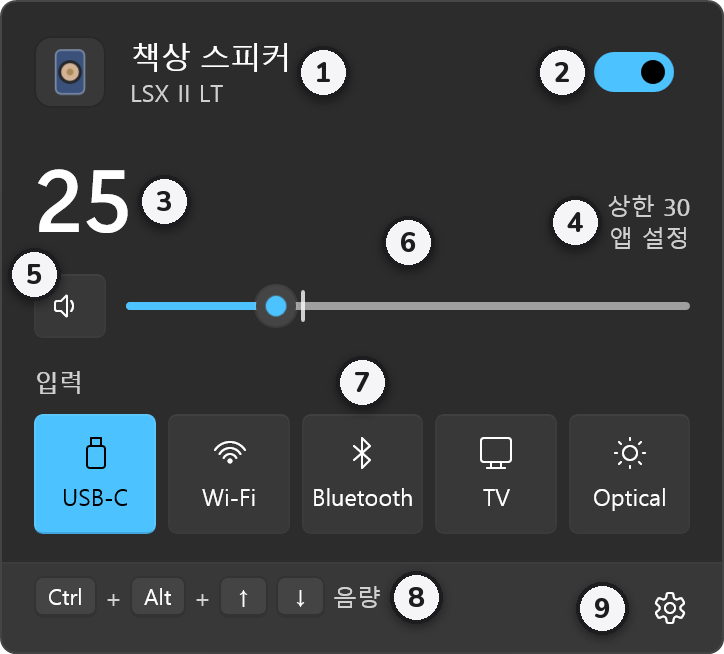

1. **스피커 이름과 모델**: 스피커를 두 대 이상 등록하면 이름 옆에 꺾쇠가 붙고, 누르면 다른 스피커를 고르는 목록이 열립니다.
2. **전원**: 끄면 스피커가 대기 상태가 됩니다.
3. **음량**: 스피커가 알려 준 실제 값입니다.
4. **상한**: 지금 적용되는 상한과, 그 값이 앱 설정인지 KEF 기기 설정인지 보여 줍니다.
5. **음소거**: 누를 때마다 음소거와 해제가 바뀝니다.
6. **음량 슬라이더**: 1 단위로 움직입니다. 세로 눈금이 상한이고, 그보다 높게는 올라가지 않습니다.
7. **입력**: 누르면 그 입력으로 바뀝니다. 바꾸는 동안 잠깐 음소거하고, 새 입력의 음량이 전보다 크지 않고 상한 안일 때만 음소거를 풉니다.
8. **단축키 안내**: 음량을 올리고 내리는 단축키입니다.
9. **설정**: 설정, 정보, 종료가 있습니다.

### 대기 상태에서 켜기

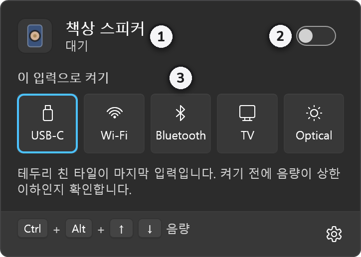

1. 이름 아래에 **대기**가 보입니다.
2. **전원**을 켜면 마지막 입력으로 켜집니다.
3. 입력을 누르면 그 입력으로 바로 켜집니다. 테두리가 있는 타일이 마지막 입력입니다.

켜기 전에 음량이 상한 안에 있는지 확인합니다. 대기 전 음량이 상한보다 높으면 켜지 않고 이유를 알려 줍니다.

### 음소거 상태

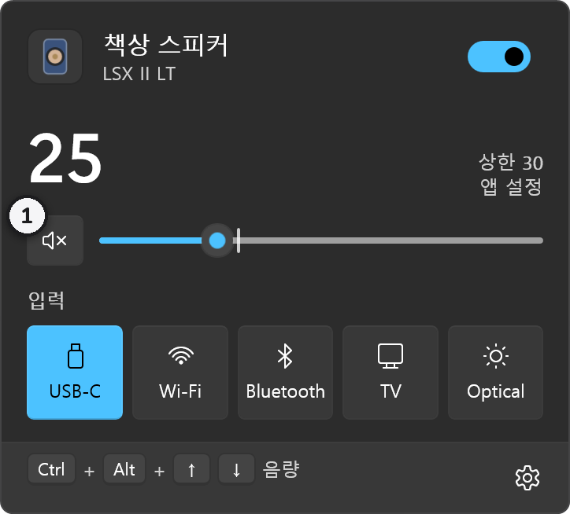

1. 음소거 중에는 버튼의 스피커에 × 표시가 붙습니다. 다시 누르면 풀립니다.

### 재생 중인 곡

스피커가 Wi-Fi나 블루투스로 재생할 때(Spotify Connect, AirPlay, Chromecast 등) 플라이아웃 위에 곡 카드가 나타납니다. Windows 11에서 빠른 설정 위에 미디어 컨트롤이 뜨는 자리입니다.

- 재생 중인 서비스, 곡 제목과 아티스트, 앨범 커버가 보입니다.
- **이전 곡**, **재생/일시 정지**, **다음 곡**은 스피커의 플레이어를 직접 조작합니다. 서비스가 허용하지 않는 버튼은 흐리게 보입니다.
- 플라이아웃이 열려 있을 때만 보이고 포커스를 가져가지 않아, 카드를 눌러도 플라이아웃이 닫히지 않습니다.
- 설정 **일반**의 **재생 중인 곡 표시**로 끌 수 있습니다.

### 단축키와 음량 표시창

어느 앱에서든 <kbd>Ctrl</kbd>+<kbd>Alt</kbd>+<kbd>↑</kbd> / <kbd>↓</kbd>로 음량을, <kbd>Ctrl</kbd>+<kbd>Alt</kbd>+<kbd>M</kbd>으로 음소거를 바꿉니다. 음량이 바뀌면 마우스 포인터가 있는 모니터의 오른쪽 아래에 표시창이 잠깐 나타납니다.

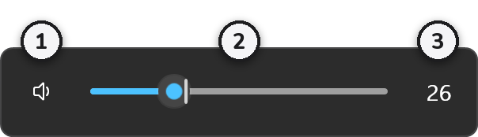

1. **스피커 아이콘**: 누르면 음소거와 해제가 바뀝니다.
2. **음량 막대**: 세로 눈금이 상한입니다. 표시창 위에서 마우스 휠을 굴려도 음량이 바뀝니다.
3. **현재 음량**

스피커가 두 대 이상이면 표시창 아래 줄에 어느 스피커인지 이름이 보입니다.

다른 앱이 같은 조합을 쓰고 있으면 플라이아웃 아래에 **단축키 확인 필요**가 보입니다. VS Code, JetBrains IDE, Visual Studio, Word도 이 조합 일부를 쓰니, 겹치면 설정의 **단축키**에서 바꾸세요.

### 설정: 일반

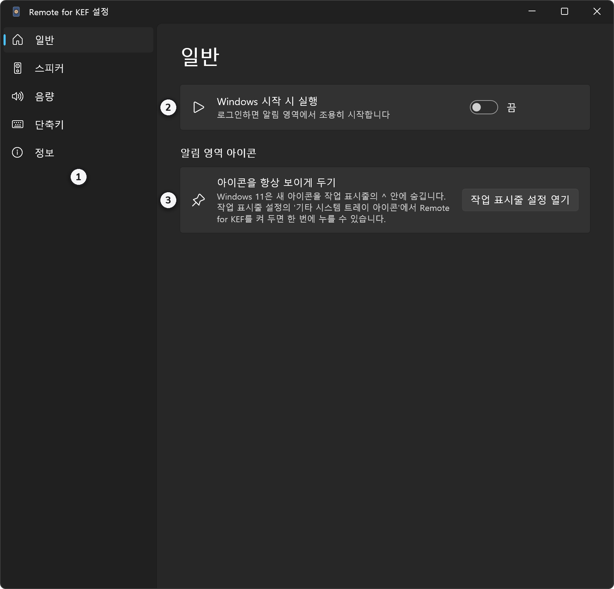

1. **메뉴**: 일반, 스피커, 단축키, 정보 화면으로 옮겨 갑니다.
2. **Windows 시작 시 실행**: 로그인하면 알림 영역에서 조용히 시작합니다.
3. **아이콘을 항상 보이게 두기**: Windows 11은 새 아이콘을 ^ 안에 숨깁니다. **작업 표시줄 설정 열기**를 눌러 Remote for KEF를 켜 두면 한 번에 열 수 있습니다.

같은 화면 아래쪽의 **업데이트**: **자동으로 업데이트**를 켜 두면 하루에 한 번 GitHub에서 새 버전을 확인해 내려받고, 다음에 앱을 시작할 때 적용합니다. **업데이트 확인**은 바로 확인하고, **다시 시작해 업데이트**는 받아 둔 버전을 곧바로 적용합니다.

같은 화면의 **플라이아웃 → 재생 중인 곡 표시**: 플라이아웃 위의 곡 카드를 켜고 끕니다.

### 설정: 스피커

스피커가 한 대일 때의 화면입니다. 두 대 이상이면 먼저 목록이 나오고, 줄을 누르면 그 스피커의 같은 화면이 열립니다([여러 스피커](#여러-스피커)).

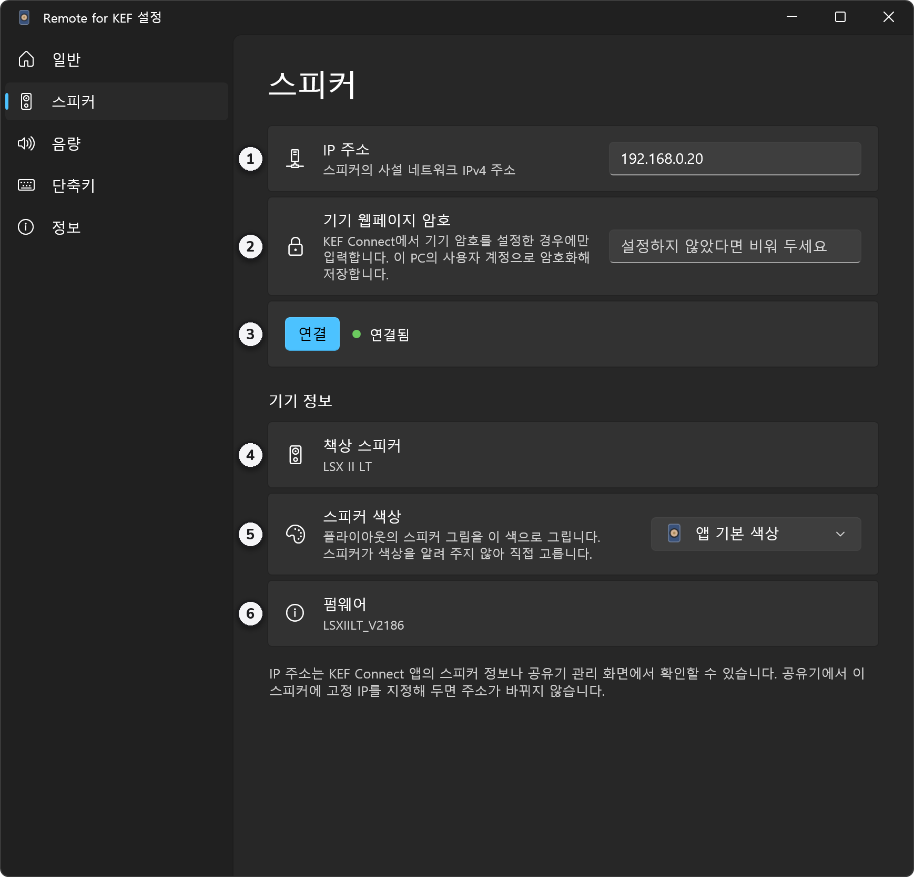

1. **IP 주소**
2. **기기 웹페이지 암호**: 정하지 않았다면 비워 둡니다. 이 PC의 사용자 계정으로 암호화해 저장합니다.
3. **연결**: 옆에 연결 상태가 보입니다.
4. **기기 이름과 모델**: 연결되면 스피커가 알려 준 값이 보입니다.
5. **스피커 색상**: 스피커는 자기 색을 알려 주지 않아 여기서 고릅니다. 목록에는 그 모델의 색만 보이고, 플라이아웃의 스피커 그림이 이 색으로 바뀝니다. 고르지 않으면 앱 기본색(LS60 Royal Blue)입니다. 모델별 그림은 [아래](#스피커-그림)에 있습니다.
6. **펌웨어**

같은 화면 아래쪽의 **음량**은 이 스피커에만 적용됩니다.

- **앱 음량 상한**: 이 앱으로 올릴 수 있는 최대 음량입니다.
- **KEF 기기 최대 음량**: KEF Connect에서 정한 값입니다.
- **지금 적용되는 상한**: 둘 중 낮은 값입니다. 플라이아웃 슬라이더의 눈금이 이 값입니다.
- **정확한 음량 맞추기**: **?** 버튼을 누르면 짧은 설명이 나옵니다. 자세한 내용은 [아래](#정확한-음량-맞추기)에 있습니다.

그 아래 **이 스피커 삭제**는 이 PC의 목록에서만 지우고, 스피커 자체는 바꾸지 않습니다. 화면 맨 위의 **스피커 추가**로 다른 방의 스피커를 더합니다.

### 설정: 단축키

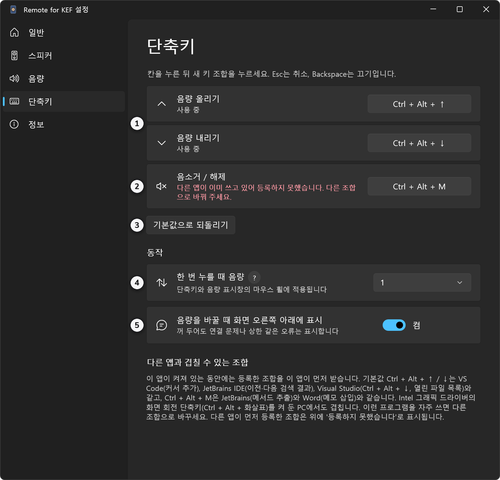

1. **음량 올리기**, **음량 내리기**: 칸을 누르고 새 조합을 누르면 바뀝니다. <kbd>Esc</kbd>는 취소, <kbd>Backspace</kbd>는 끄기입니다.
2. **음소거 / 해제**: 사진은 다른 앱이 <kbd>Ctrl</kbd>+<kbd>Alt</kbd>+<kbd>M</kbd>을 먼저 쓰고 있을 때의 모습입니다. 이렇게 빨간 글씨가 보이면 다른 조합으로 바꾸세요.
3. **기본값으로 되돌리기**: 단축키를 처음 조합으로 되돌립니다.
4. **한 번 누를 때 음량**: 1, 2, 3, 5 또는 **체감 음량 기준**. 단축키와 표시창의 마우스 휠에 함께 적용됩니다.
5. **음량을 바꿀 때 화면 오른쪽 아래에 표시**: 꺼 두어도 연결 문제나 상한 같은 오류는 표시합니다.

같은 화면의 **다음 스피커로 바꾸기**는 기본으로 꺼져 있습니다. 조합을 정해 두면 스피커가 두 대 이상일 때 선택한 스피커를 목록 순서대로 바꿉니다.

**체감 음량 기준**은 같은 숫자씩 더하는 대신 소리 크기가 고르게 늘도록 미리 잰 단계(12, 15, 19, 22, 25, 29 …)를 따릅니다. 65 위에서는 4씩 움직이고, 12 아래에서는 올리면 12, 내리면 0으로 갑니다.

## macOS

### 메뉴 막대 아이콘

아이콘 모양으로 스피커 상태를 알 수 있습니다. 아이콘을 누르면 패널이 열립니다.

1. **켜짐**: 옆의 숫자는 지금 음량입니다.
2. **음소거**
3. **대기**
4. **숫자를 끈 경우**: 설정의 **메뉴 막대에 음량 숫자 표시**를 끄면 아이콘만 남습니다.

연결이 끊기면 아이콘 모양이 한 번 더 바뀝니다.

### 패널

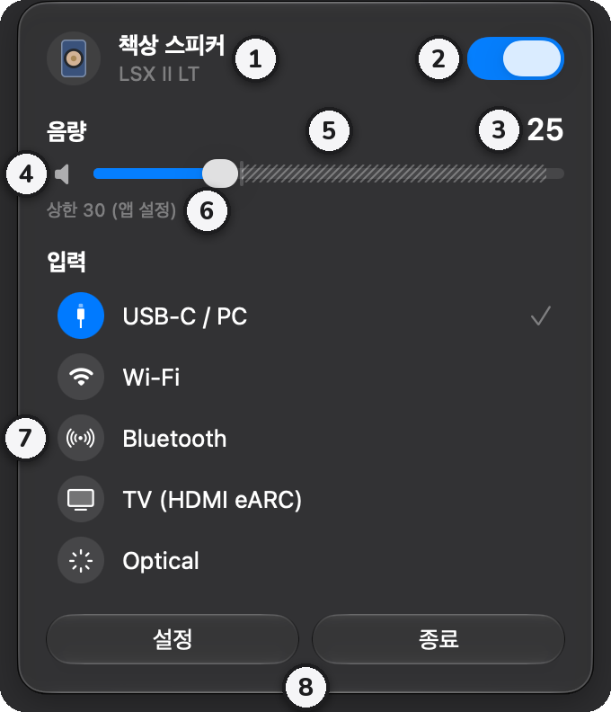

1. **스피커 이름과 모델**: 스피커를 두 대 이상 등록하면 이름 옆에 꺾쇠가 붙고, 누르면 패널 옆에 다른 스피커를 고르는 목록이 열립니다.
2. **전원**: 끄면 대기 상태가 됩니다.
3. **음량**: 스피커가 알려 준 실제 값입니다.
4. **음소거**: 스피커 아이콘을 누르면 음소거와 해제가 바뀝니다.
5. **음량 슬라이더**: 빗금 부분은 상한보다 높은 구간이라 올라가지 않습니다.
6. **상한**: 지금 적용되는 상한과 그 출처입니다.
7. **입력**: 누르면 그 입력으로 바뀝니다. 체크 표시가 지금 입력입니다. 바꾸는 방식은 Windows와 같습니다.
8. **설정**과 **종료**

### 대기 상태에서 켜기

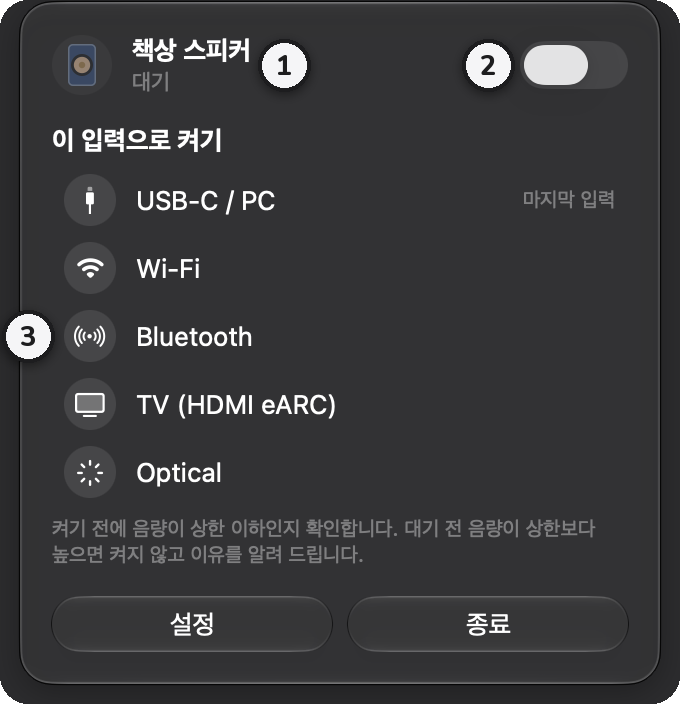

1. 이름 아래에 **대기**가 보입니다.
2. **전원**을 켜면 마지막 입력으로 켜집니다.
3. 입력을 누르면 그 입력으로 바로 켜집니다. **마지막 입력**이라고 적힌 것이 마지막 입력입니다.

### 음소거 상태

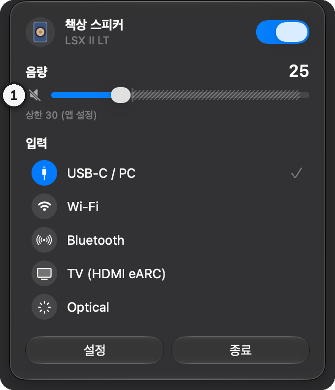

1. 음소거 중에는 스피커 아이콘에 사선이 그어집니다. 다시 누르면 풀립니다.

### 재생 중인 곡

스피커가 Wi-Fi나 블루투스로 재생할 때 패널의 음량 위에 곡 타일이 나타납니다. 제어 센터의 지금 재생 중과 같은 모양으로, 앨범 커버, 곡 제목, 아티스트와 앨범, **이전 곡**, **재생/일시 정지**, **다음 곡** 버튼이 있습니다. 설정 **일반**의 **재생 중인 곡 표시**로 끌 수 있습니다.

### 단축키와 음량 표시창

어느 앱에서든 <kbd>⌃</kbd><kbd>⌥</kbd><kbd>⌘</kbd><kbd>↑</kbd> / <kbd>↓</kbd>로 음량을, <kbd>⌃</kbd><kbd>⌥</kbd><kbd>⌘</kbd><kbd>M</kbd>으로 음소거를 바꿉니다. 누르고 있으면 계속 바뀝니다. 음량이 바뀌면 화면 오른쪽 위, 메뉴 막대 아래에 시스템 음량 표시창과 같은 유리로 된 표시창이 잠깐 나타납니다. 막대의 세로 눈금이 상한이고, 숫자는 메뉴 막대 아이콘 옆에 보입니다. 포인터를 올리면 막대가 끌어서 바꿀 수 있는 슬라이더로 바뀌고, 포인터를 뗄 때까지 사라지지 않습니다. 손쉬운 사용 권한은 필요 없습니다. Mac의 음량 키처럼 음소거 중에 음량을 올리면 음소거가 풀립니다. 스피커가 두 대 이상이면 표시창 왼쪽 아이콘이 그 스피커의 모델 그림으로 바뀌어 어느 스피커인지 알려 줍니다.

### 설정: 일반

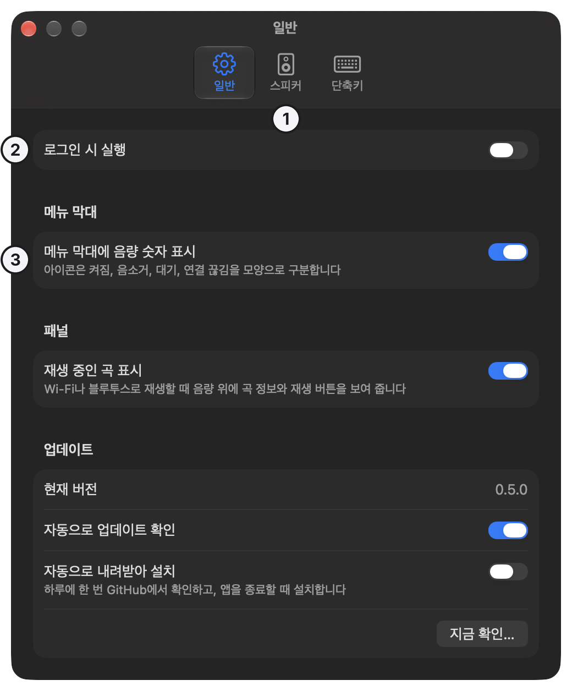

1. **탭**: 일반, 스피커, 단축키
2. **로그인 시 실행**: 처음 켤 때 시스템 설정에서 승인이 필요할 수 있습니다.
3. **메뉴 막대에 음량 숫자 표시**: 기본으로 켜져 있습니다. 끄면 아이콘만 남습니다.

같은 탭의 **업데이트**: **자동으로 업데이트 확인**을 켜 두면 하루에 한 번 확인하고, **자동으로 내려받아 설치**도 켜면 앱을 종료할 때 설치합니다. **지금 확인…** 버튼은 바로 확인합니다. 앱이 메뉴 막대에 있는 동안 찾은 업데이트는 **설치…** 버튼을 누를 때까지 패널에 한 줄로 보입니다.

같은 탭의 **패널 → 재생 중인 곡 표시**: 패널의 음량 위 곡 타일을 켜고 끕니다.

### 설정: 스피커

스피커가 한 대일 때의 탭입니다. 두 대 이상이면 목록이 되고, 줄의 ⓘ를 누르면 그 스피커의 같은 내용이 열립니다([여러 스피커](#여러-스피커)).

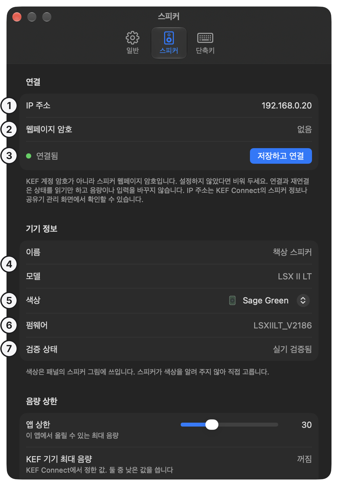

1. **IP 주소**
2. **웹페이지 암호**: 정하지 않았다면 비워 둡니다. 키체인에 저장합니다.
3. **저장하고 연결**: 왼쪽에 연결 상태가 보입니다.
4. **이름과 모델**: 연결되면 스피커가 알려 준 값이 보입니다.
5. **색상**: 패널의 스피커 그림 색입니다. 목록에는 그 모델의 색만 보이고, 고르지 않으면 앱 기본색(LS60 Royal Blue)입니다. 모델별 그림은 [아래](#스피커-그림)에 있습니다.
6. **펌웨어**
7. **검증 상태**: 실제 스피커로 확인한 모델인지 보여 줍니다.

아래로 내리면 이 스피커에만 적용되는 음량 설정이 이어집니다.

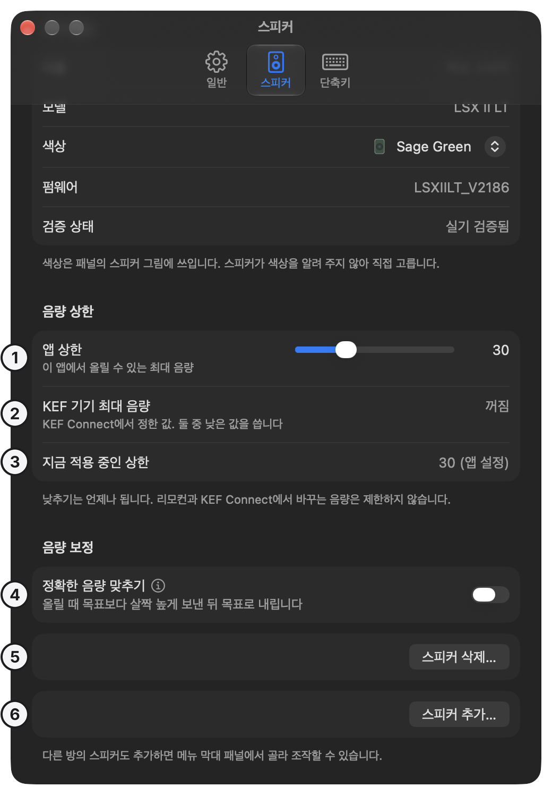

1. **앱 상한**: 슬라이더로 정합니다.
2. **KEF 기기 최대 음량**
3. **지금 적용 중인 상한**
4. **정확한 음량 맞추기**: 이름 옆의 ⓘ를 누르면 짧은 설명이 나옵니다.
5. **스피커 삭제…**: 이 Mac의 목록에서만 지우고, 스피커 자체는 바꾸지 않습니다.
6. **스피커 추가…**: 다른 방의 스피커를 더합니다.

### 설정: 단축키

- **음량 올리기**, **음량 내리기**, **음소거 켜기/끄기**: 칸을 누르고 새 조합을 누르면 바뀝니다. <kbd>esc</kbd>는 취소, <kbd>delete</kbd>는 끄기입니다. 기능 키(F1~F20)가 아니면 <kbd>⌃</kbd>, <kbd>⌥</kbd>, <kbd>⌘</kbd> 중 하나 이상을 함께 눌러야 합니다.
- **다음 스피커로 바꾸기**: 기본으로 꺼져 있습니다. 조합을 정해 두면 스피커가 두 대 이상일 때 선택한 스피커를 목록 순서대로 바꿉니다.
- **기본값으로 되돌리기**: 단축키를 처음 조합으로 되돌립니다.
- **한 번 누를 때 음량**: 1, 2, 3, 5 또는 **체감 음량 기준**. Windows와 같습니다.
- **음량을 바꿀 때 화면에 표시**: 꺼 두어도 연결 문제와 상한은 표시합니다.

## 여러 스피커

방마다 다른 KEF 스피커를 등록해 두고, 그중 하나를 골라 조작합니다. 한 대만 쓰면 화면은 지금까지와 같습니다. 스피커는 설정 **스피커** 화면의 **스피커 추가**에서 IP 주소를 넣어 더합니다.

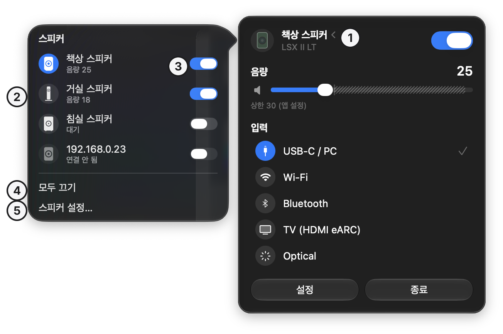

1. **스피커 이름**: 누르면 옆에 목록이 열리고 꺾쇠 방향이 바뀝니다. 다시 누르면 닫힙니다. Windows의 플라이아웃도 같습니다.
2. **스피커 줄**: 누르면 그 스피커로 바뀝니다. 이름 아래에 음량, 대기, 연결 안 됨 같은 상태가 보입니다. 앱을 다시 켜도 마지막에 고른 스피커가 그대로 선택됩니다.
3. **전원 스위치**: 고르지 않고도 그 스피커를 켜고 끕니다.
4. **모두 끄기**: 켜져 있는 스피커를 모두 대기 상태로 돌립니다.
5. **스피커 설정…**: 설정의 스피커 화면을 엽니다. Windows는 **스피커 관리**입니다.

- **선택한 스피커를 따라가는 것**: 플라이아웃과 패널, 알림 영역과 메뉴 막대 아이콘, 단축키와 음량 표시창입니다. 표시창은 어느 스피커인지 함께 보여 줍니다(Windows는 이름, macOS는 모델 그림).
- **스피커마다 따로 정하는 것**: 주소, 암호, 색상, 모델 선택, 앱 상한, 정확한 음량 맞추기. 단축키, 한 번 누를 때 음량, 표시창, 재생 중인 곡 표시, 자동 실행, 업데이트는 모든 스피커에 같습니다.
- **다음 스피커로 바꾸기**: 설정 **단축키**에서 조합을 정해 두면 목록을 열지 않고 선택한 스피커를 목록 순서대로 바꿉니다. 기본으로 꺼져 있습니다.

선택한 스피커만 계속 연결해 두고 바뀐 것을 곧바로 받습니다. 다른 스피커는 목록이 열려 있는 동안에만 몇 초마다 읽어 오므로, 스피커가 늘어도 네트워크 사용은 거의 늘지 않습니다.

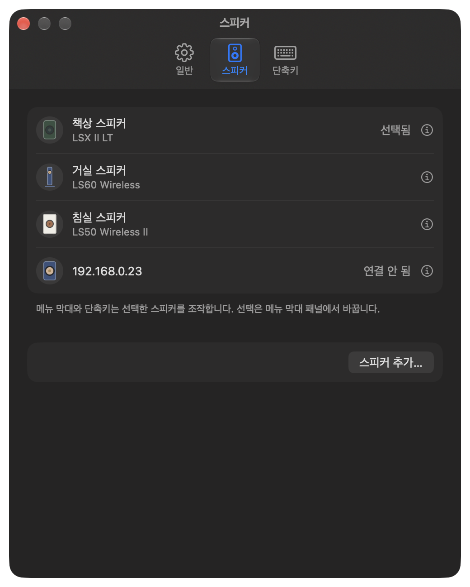

설정의 **스피커** 화면은 두 대 이상이면 목록이 됩니다. 줄마다 스피커 그림, 이름, 모델과 선택 여부가 보입니다. Windows는 줄을 누르면, macOS는 ⓘ를 누르면 그 스피커의 설정이 열리고, 내용은 한 대일 때의 [Windows](#설정-스피커)·[macOS](#설정-스피커-1) 화면과 같습니다.

## 음량 상한과 정확한 음량 맞추기

### 음량 상한

상한은 두 가지이고, 낮은 쪽이 적용됩니다. 둘 다 스피커마다 따로입니다. 이 앱에서 정하는 **앱 상한**과, KEF Connect에서 정하는 **KEF 기기 최대 음량**입니다. 내리는 것은 언제나 되고, 리모컨이나 KEF Connect로 바꾼 음량은 제한하지 않습니다. 이미 상한보다 높으면 내리기만 할 수 있습니다.

### 정확한 음량 맞추기

KEF 스피커는 일부 구간에서, 아래에서 올라온 음량이 같은 숫자인데도 더 작게 들립니다. 이 기능을 켜면 음량을 올릴 때 조금 높은 값을 먼저 보내고 0.1초 뒤 목표 값을 보내서, 위에서 내려온 것과 같은 크기로 들리게 합니다.

- 20으로 올리면 22를 거치고, 12로 올리면 17을 거칩니다.
- 5 이하와 41 이상은 바로 보냅니다. 중간 값은 상한을 넘지 않고, 내릴 때는 그대로 보냅니다.

측정값은 [kef-lsx-volume](https://github.com/roberdorfer/kef-lsx-volume)이 LSX II(USB 입력)에서 잰 것입니다. LSX II LT에서는 아직 확인하지 않아 기본으로 꺼져 있습니다.

## 스피커 그림

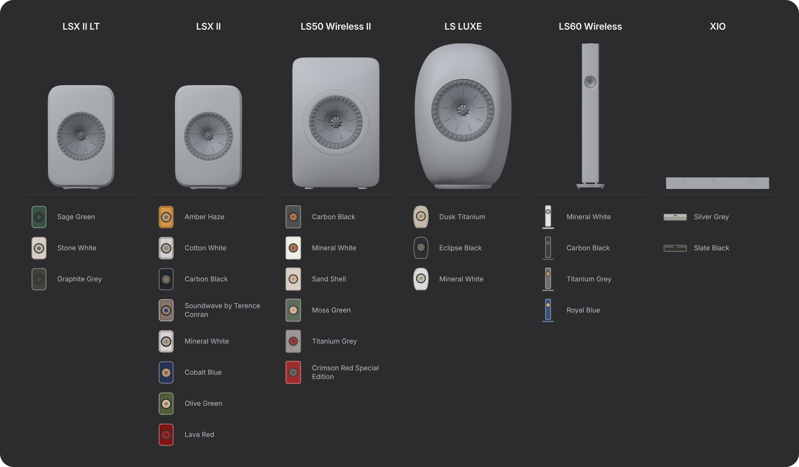

플라이아웃과 패널 머리의 스피커 그림은 모델마다 모양이 다릅니다. 위는 KEF 3D 모델을 단색으로 렌더링한 것이고, 아래는 작은 크기에서도 알아보도록 앱이 이를 단순하게 옮긴 색상별 그림입니다. 책장형 네 모델은 실제 크기 비율 그대로이고, LS60 Wireless와 XIO는 칸에 맞춰 줄였습니다.

- 색상을 고르면 그 색상이 있는 모델의 모양을 그 색으로 그립니다.
- 색상을 고르지 않으면 인식된 모델의 모양을 앱 기본색(LS60 Royal Blue)으로 그립니다.
- 앱이 모르는 모델이면 그림에 쓸 모델을 고를 수 있습니다. Windows는 설정 **스피커** 화면의 **스피커 모델**, macOS는 설정 **스피커** 탭의 **모델 선택**입니다. 고르기 전에는 앱 아이콘과 같은 그림입니다.
- 색상 목록에는 그 모델의 색만 보이고, 모델을 모르면 앱 기본색만 있습니다. 모델 선택은 그림과 색상 목록에만 쓰이고, 입력 목록은 바뀌지 않습니다.

## 문제 해결

- **연결되지 않을 때**: 스피커 전원과 Wi-Fi 연결을 확인하세요. PC나 Mac이 스피커와 같은 네트워크에 있어야 합니다. 스피커의 IP 주소가 바뀌었을 수도 있습니다. macOS에서는 **시스템 설정 → 개인정보 보호 및 보안 → 로컬 네트워크**에서 Remote for KEF가 켜져 있는지 확인하세요. 앱은 연결이 끊기면 계속 다시 시도합니다.
- **Windows에서 실행이 막힐 때**: 스마트 앱 컨트롤이 켜져 있으면 서명하지 않은 앱은 **실행** 버튼 없이 막힙니다. 이 앱만 예외로 둘 수는 없고, 스마트 앱 컨트롤을 꺼야 실행됩니다. 끄기 전에 [Microsoft 안내](https://support.microsoft.com/ko-kr/topic/what-is-smart-app-control-285ea03d-fa88-4d56-882e-6698afdb7003)를 확인하세요.
- **단축키가 듣지 않을 때**: 다른 앱이 같은 조합을 쓰고 있을 수 있습니다. 설정의 **단축키**에서 다른 조합을 고르세요. macOS에서는 Mission Control처럼 시스템이 쓰는 조합이면 설정된 것으로 보여도 앱까지 오지 않을 수 있습니다.
- **재생 중인 곡이 보이지 않을 때**: 곡 카드와 타일은 Wi-Fi와 블루투스 입력에서 곡을 재생하거나 일시 정지한 동안, 설정의 **재생 중인 곡 표시**가 켜져 있을 때만 보입니다. USB나 광 같은 유선 입력은 곡 정보를 보내지 않습니다.
- **앱에서 켜지지 않을 때**: 네트워크로 켤 수 없는 기기는 앱이 알려 줍니다. 리모컨이나 KEF Connect로 켜세요.
- **그 밖의 문제**: Windows는 설정의 **정보 → 설정과 로그 폴더**에 기록이 남습니다. [Issues](https://github.com/kimdaehee0824/Remote-for-KEF/issues)에 알려 주시면 확인하겠습니다.
